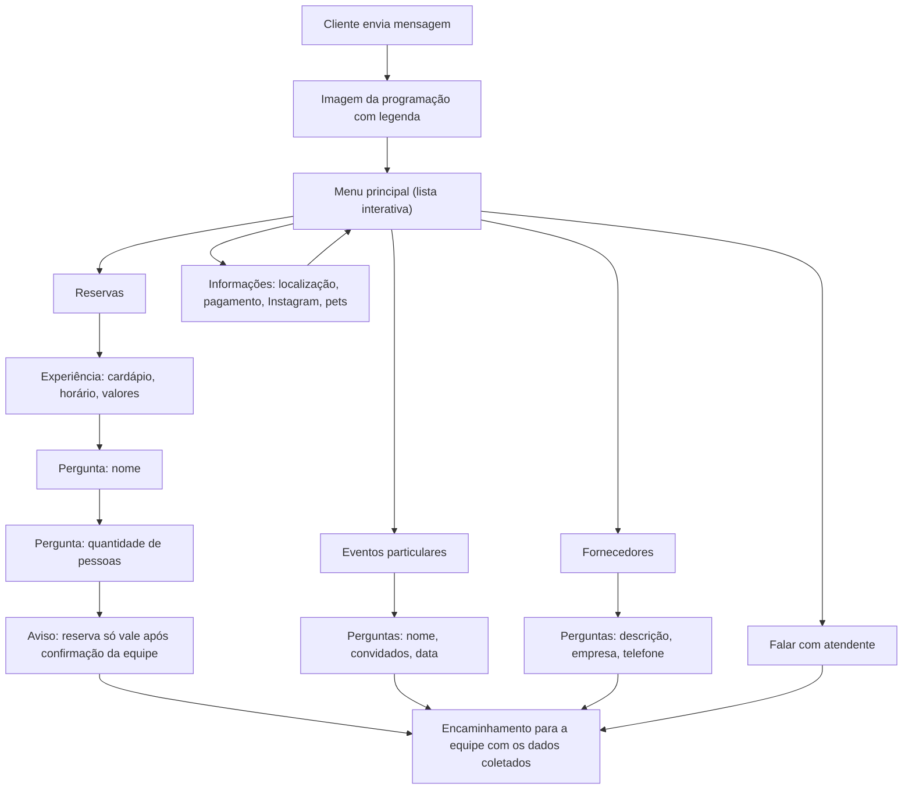
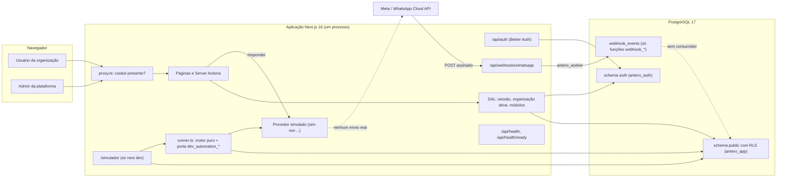
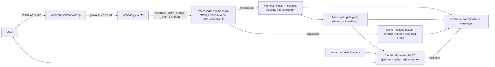
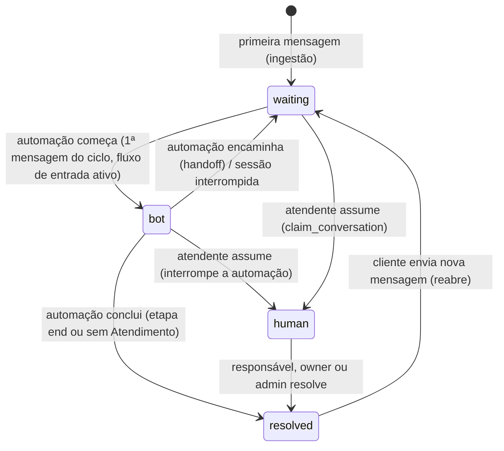
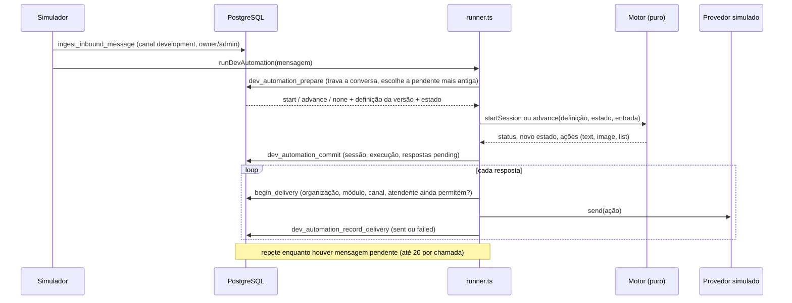
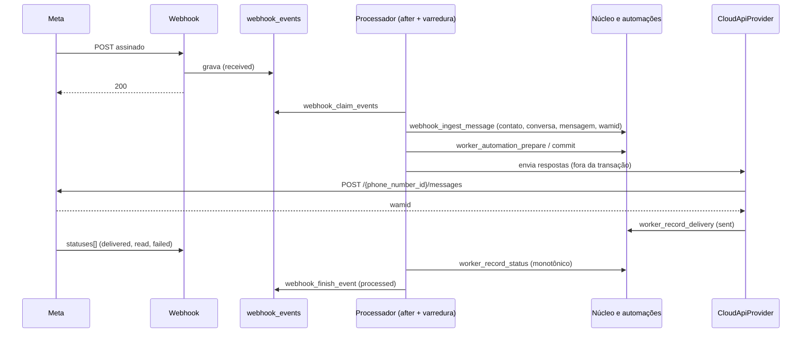
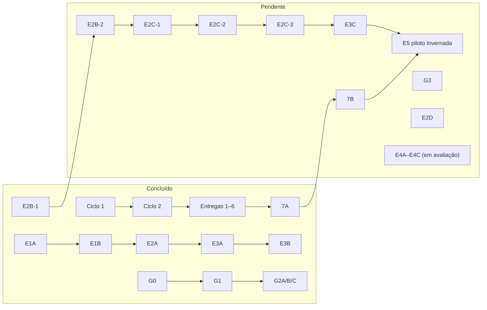
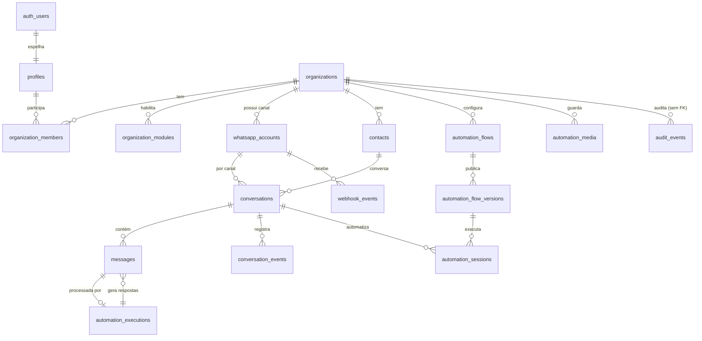

# Antero Atendimentos — Visão de Produto, Arquitetura e Estado Atual

| Campo | Valor |
| --- | --- |
| Data de geração | 2026-11-25 |
| Branch analisada | `main` |
| Commit analisado | `4a26a4b36d613cf2866bd98b8990a1b5e71fa638` (merge do PR #17, `feat/e2b1-whatsapp-webhook`, 2026-11-25) |
| `main` local | `4a26a4b`, igual a `origin/main` **segundo a referência local** |
| Referências remotas locais | `origin/main` (`4a26a4b`), `origin/feat/e2b1-whatsapp-webhook` (`9383517`), `origin/feat/inbox-funcional-simulador` (`ebcdeed`), `origin/feat/ciclo-2-rpc-ingestao-inbound` (`bb47e46`), `origin/chore/retomada-tecnica` (`75c6251`) |
| Working tree no início da auditoria | limpa (`git status`: `## main...origin/main`, sem alterações) |
| Tipo de auditoria | só leitura: análise estática, histórico Git, documentação e um comando de inspeção (`pnpm db:migrate:status`) |
| Limitação | **nenhum `git fetch` foi executado.** O estado do GitHub pode ser mais novo que as referências locais. Nenhuma suíte de testes, build ou migration foi executada |

> **Retrato datado.** Este documento descreve o projeto em 2026-11-25. Antes de usar
> qualquer informação daqui como verdade atual, confira o código, a branch, a working
> tree (`git status`, `git log`) e o estado do banco (`pnpm db:migrate:status`). Em caso de
> divergência, o código vence.

---

## Sumário

1. [Resumo executivo](#1-resumo-executivo)
2. [Como ler este documento](#2-como-ler-este-documento)
3. [Visão de produto](#3-visão-de-produto)
4. [Casos de uso comerciais](#4-casos-de-uso-comerciais)
5. [Arquitetura técnica](#5-arquitetura-técnica)
6. [Multiempresa e segurança](#6-multiempresa-e-segurança)
7. [Autenticação e gestão de acesso](#7-autenticação-e-gestão-de-acesso)
8. [Atendimento e Inbox](#8-atendimento-e-inbox)
9. [Chatbot e motor de automações](#9-chatbot-e-motor-de-automações)
10. [Integração com WhatsApp](#10-integração-com-whatsapp)
11. [Confirmação da auditoria anterior](#11-confirmação-da-auditoria-anterior)
12. [Estado das entregas](#12-estado-das-entregas)
13. [Banco de dados](#13-banco-de-dados)
14. [Infraestrutura e produção](#14-infraestrutura-e-produção)
15. [Integração futura com o Antero Pedidos](#15-integração-futura-com-o-antero-pedidos)
16. [Testes e qualidade](#16-testes-e-qualidade)
17. [Guia de onboarding](#17-guia-de-onboarding)
18. [Colaboração entre dois desenvolvedores](#18-colaboração-entre-dois-desenvolvedores)
19. [Roadmap](#19-roadmap)
20. [Riscos, bloqueadores e débitos técnicos](#20-riscos-bloqueadores-e-débitos-técnicos)
21. [Contexto para agentes de IA](#21-contexto-para-agentes-de-ia)
22. [Divergências entre documentação e código](#22-divergências-entre-documentação-e-código)
23. [Referências](#23-referências)

---

## 1. Resumo executivo

1. **O que é o Antero Atendimentos?** Uma plataforma SaaS multiempresa, da Antero Sistemas,
   para centralizar e automatizar o atendimento de empresas pelo WhatsApp. É uma única
   aplicação; cada empresa cliente é uma **organização** isolada, com usuários, canal,
   contatos, conversas, fluxos e configuração próprios
   ([`.claude/tasks/001_initial_mvp.md`](../.claude/tasks/001_initial_mvp.md), [`MVP.md`](MVP.md)).
2. **Por que estamos desenvolvendo?** Para vender um produto reutilizável e modular a
   várias empresas, em vez de construir um chatbot por cliente. A Antero seria a primeira
   usuária, para demonstrar a tecnologia que oferece (briefing original).
3. **Que problemas resolve?** Atendimento repetitivo e manual no WhatsApp: perguntas
   recorrentes, menus de opções, coleta de dados (nome, quantidade de pessoas etc.),
   triagem e passagem para um humano, organização de conversas por equipe.
4. **Potenciais primeiros clientes:** a própria Antero, a **Invernada do Sol** (atendimento
   automatizado, piloto recomendado) e a **Saint Honoré Luxo** (campanhas promocionais,
   oportunidade em avaliação). Nenhum contrato do Antero Atendimentos foi encontrado.
5. **Arquitetura:** monólito modular em **Next.js 16** (App Router, Server Components e
   Server Actions), **PostgreSQL 17 próprio** com **RLS** em todas as tabelas de negócio,
   **Better Auth 1.7.12** para identidade, acesso SQL com `pg` (sem ORM), migrations SQL com
   **dbmate**, imagem Docker de produção. Sem microsserviços, sem Redis, sem fila externa.
6. **O que está pronto (na `main`, com testes de entregas anteriores):** login e sessões;
   organizações, suspensão e módulos por organização; isolamento por RLS; Inbox com
   assumir, responder e resolver; motor de automações e editor de fluxos (rascunho,
   validação, prévia, publicação, versões, restauração, imagens); central administrativa
   da plataforma com auditoria e histórico; webhook da Meta assinado com gravação durável
   dos eventos (E2B-1); imagem Docker com health checks e homologação local.
7. **O que ainda é simulado:** toda mensagem recebida entra pelo `/simulador` (só em
   `pnpm dev`); todo envio sai pelo provedor simulado (`sim-out-…`); a automação só roda
   pela porta de desenvolvimento (`dev_automation_*`) e **nunca roda no build de produção**.
8. **Existe integração real com WhatsApp?** **Parcial.** Existe o **recebimento**: a rota
   `/api/webhooks/whatsapp` valida a assinatura e grava os eventos em `webhook_events`.
   **Não existe processamento** desses eventos (nenhum consumidor da fila), **nem envio HTTP**
   para a Cloud API. A migration 0014 está na `main`, mas **não está aplicada no banco de
   desenvolvimento** (conferido nesta auditoria).
9. **Existe chatbot funcional?** Sim, **determinístico** (fluxos e regras, sem IA), funcional
   no simulador e na prévia do editor.
10. **Funciona com mensagens reais?** **Não.** Uma mensagem real é gravada como evento bruto
    e para aí.
11. **Existe ambiente de produção?** **Não.** A Entrega 7A (imagem e homologação local) está
    pronta; a 7B (Coolify/VPS) está **pausada** desde 2026-10-30. Não há HTTPS público.
12. **Principais bloqueadores:** processamento dos eventos (E2B-2), provedor Cloud API
    (E2C-1/E2C-2), envio de imagens do painel (E2C-3), ambiente público com HTTPS (7B),
    caminho de produção para o primeiro administrador, verificação e App Review na Meta.
13. **Onde paramos?** A E2B-1 (webhook e eventos brutos) foi integrada à `main` hoje
    (PR #17). O próximo passo do roteiro é a **E2B-2** (ingestão e automação reais a partir
    da fila).
14. **Próxima entrega recomendada:** **E2B-2**, precedida da consolidação (aplicar a 0014 no
    dev com autorização e backup). Ver [Roadmap](#19-roadmap).
15. **Frentes paralelas para dois desenvolvedores:** (A) comunicação real com o WhatsApp
    (E2B-2 → E2C-1 → E2C-2 → E2C-3) e (B) produção e operação (retomada da 7B, primeiro
    administrador, HTTPS público, backup, correção da suíte `homolog:e2e`). Ver
    [seção 18.6](#186-divisão-recomendada-de-trabalho).

### Estado por módulo

Legenda dos estados na [seção 2](#2-como-ler-este-documento).

| Módulo / área | Estado | Observação |
| --- | --- | --- |
| Autenticação (Better Auth) | Implementado, com validação anterior | Sem cadastro público; rate limit por IP em memória |
| Organizações e suspensão (E1A) | Implementado, com validação anterior | Criar organização só por SQL de manutenção |
| Módulos por organização (E1B) | Implementado, com validação anterior | 4 módulos: `atendimento`, `automacoes`, `contatos`, `campanhas` |
| Central do admin da plataforma (G1, G2B, G2C) | Implementado, com validação anterior | Só lê, suspende e liga módulos; não lê dados operacionais |
| Equipe | Parcial | Lista de membros só leitura; sem convites nem gestão de papéis |
| Inbox / Atendimento (E2A) | Implementado, com validação anterior; envio **simulado** | Sem transferência entre atendentes |
| Motor de automações (E3A) | Implementado, com validação anterior; execução **simulada** | Só porta de desenvolvimento |
| Editor de fluxos (E3B) | Implementado, com validação anterior | Prévia em memória; sem edição simultânea |
| Webhook WhatsApp (E2B-1) | Implementado, com validação anterior (testes e homologação com eventos sintéticos) | 0014 não aplicada no dev; nunca recebeu evento real documentado |
| Processamento de eventos (E2B-2) | Não implementado | Fila existe no banco, sem consumidor |
| Envio pela Cloud API (E2C) | Não implementado | Só formatação pura em `cloud-api.ts` |
| Contatos (módulo comercial) | Não implementado | Página "Em breve"; só a tabela núcleo `contacts` existe |
| Campanhas | Não implementado | Página "Em breve"; nenhuma tabela |
| Visão geral (métricas) | Parcial | Indicadores mostram "—" ("Disponível no Ciclo 2") |
| Docker / homologação local (7A) | Implementado, com validação anterior | Suíte `homolog:e2e` com falhas conhecidas (ver seção 16) |
| Deploy Coolify (7B) | Apenas documentado (pausado) | Registro em branch não integrada |

---

## 2. Como ler este documento

### Estados usados

| Estado | Significado |
| --- | --- |
| **Implementado, com validação anterior** | Código na `main` e evidência de testes ou homologação registrada (documentação versionada ou relatórios locais). Não foi reexecutado nesta auditoria |
| **Implementado, não validado nesta auditoria** | Código na `main`, sem evidência de validação encontrada |
| **Parcial** | Parte do comportamento existe |
| **Só em branch** | Código fora da `main` |
| **Simulado** | Funciona com o provedor ou a porta de desenvolvimento, sem WhatsApp real |
| **Apenas documentado** | Existe só como texto ou plano |
| **Planejado** | Está no roadmap, sem código |
| **Não implementado** | Não existe e não está planejado de forma detalhada |
| **Não confirmado** | Não foi possível verificar |

### Origem das informações

| Marca | Origem |
| --- | --- |
| [código] | código, migrations, scripts e testes inspecionados nesta auditoria |
| [docs] | documentação versionada em `docs/` |
| [git] | histórico Git local |
| [relatório] | relatórios em `claude-reports/` (ver abaixo) |
| [prompt] | contexto comercial informado no pedido desta auditoria |
| [recomendação] | proposta desta auditoria, **não aprovada** |

### Atenção: os relatórios de entrega não estão no Git

O diretório `claude-reports/` é ignorado por `.git/info/exclude` (configuração local, não
versionada). Os relatórios de cada entrega, o plano comercial do MVP
(`claude-reports/2026-10-30-mvp-comercial-pilotos.md`) e as investigações de WhatsApp e da
administração global **existem só na máquina do desenvolvedor original**. Um clone novo não
os terá. O plano comercial fica fora do Git de propósito, porque cita dados de clientes.
Este documento consolida o que deles importa para o trabalho técnico, sem os dados
comerciais sensíveis.

---

## 3. Visão de produto

### 3.1 Problema e proposta de valor

**Problema [prompt][docs]:** empresas atendem clientes pelo WhatsApp de forma manual:
respondem as mesmas perguntas, repetem informações (horários, valores, cardápio, localização),
coletam dados à mão e perdem o controle de quem está atendendo o quê.

**Proposta de valor:**

- uma plataforma própria de atendimento por organização, com automação configurável pelo
  próprio cliente (editor de fluxos, sem código);
- passagem clara do robô para um atendente humano, com os dados já coletados;
- Inbox organizada por estado (`bot`, `waiting`, `human`, `resolved`) e por responsável;
- módulos contratáveis por organização, sem código nem deploy por cliente
  ([`MODULES.md`](MODULES.md));
- isolamento entre organizações garantido pelo banco (RLS), não só pela interface.

**Princípio registrado [docs]:** "MVP primeiro · arquitetura preparada para crescer · sem
overengineering · monólito modular · validação no servidor · segurança e isolamento
multiempresa desde o início" ([`MVP.md`](MVP.md)). É proibido criar regra com nome, id ou
identificador de cliente: toda diferença entre organizações é dado
([`MODULES.md`](MODULES.md)). Um teste impede nomes de clientes no código
([`modules.test.ts`](../src/modules/organizations/modules.test.ts)).

### 3.2 Como o produto reduz trabalho manual

| Mecanismo | Situação |
| --- | --- |
| Mensagem de boas-vindas, imagem e menu automáticos | Implementado; simulado |
| Coleta de respostas (`question`) com validação de tamanho | Implementado; simulado |
| Encaminhamento para humano com resumo dos dados coletados | Implementado; simulado |
| Comandos globais ("atendente", "menu", "voltar") | Implementado; simulado |
| Resposta automática em segundos (tempo de resposta) | Depende de E2B-2 e E2C |
| Cliente edita textos, opções e imagem da semana sozinho | Implementado (editor E3B) |
| Campanhas, listas e agendamentos | Planejado (E4), em avaliação comercial |

### 3.3 Chatbot e atendimento humano

O robô e o humano compartilham a mesma conversa. A automação começa na primeira mensagem
de um ciclo, se houver fluxo de entrada ativo e o módulo Automações estiver ligado.
Ela termina ao concluir, ao encaminhar (a conversa vai para `waiting`) ou quando um atendente
assume (o gatilho interrompe a sessão). **O humano sempre vence**: o robô não responde em
`human` nem em `waiting` depois de um encaminhamento ([`AUTOMACOES.md`](AUTOMACOES.md)).

### 3.4 Módulos por organização

Quatro módulos (`organization_module`, migration 0007): `atendimento`, `automacoes`,
`contatos` e `campanhas`. Campanhas exige Contatos. Só o administrador da plataforma liga ou
desliga um módulo, em `/admin`, e a alteração é auditada. Organização nova nasce sem
módulos. Detalhes na [seção 6.5](#65-módulos).

### 3.5 MVP original e evoluções

| Item | Classificação | Fonte |
| --- | --- | --- |
| Organizações, papéis, Inbox, contatos simulados, motor de automação com níveis, encaminhamento humano, provedor simulado, preparação para Cloud API | **MVP original confirmado** | briefing `.claude/tasks/001_initial_mvp.md`, ciclos 1–4 de [`MVP.md`](MVP.md) |
| Pagamentos, assinaturas, IA generativa, CRM completo, app mobile, microsserviços, construtor visual avançado | **Fora do escopo do MVP** | [`MVP.md`](MVP.md) |
| Editor self-service de fluxos, módulos por organização, suspensão, auditoria administrativa | **Decisões já implementadas** que evoluíram o MVP | relatórios E1A–G2C |
| Cloud API real, interativos reais, template de retorno | **Planejado** (E2B-2, E2C, E3C) | [relatório] |
| Embedded Signup e coexistência com o WhatsApp Business App | **Planejado**, depende da Meta (E2D) | [relatório] |
| Contatos com listas, consentimento, campanhas, resultado | **Oportunidade em avaliação** (E4A–E4C) | [relatório], [prompt] |
| Modo suporte da Antero dentro da organização do cliente | **Planejado** (G3) | [relatório] |
| Integração com o Antero Pedidos, identidade única entre produtos | **Ideia futura**, nada decidido | [prompt] |
| Inteligência artificial (LLM) | **Fora do escopo do MVP**; nenhum plano técnico registrado | [`MVP.md`](MVP.md) |

### 3.6 Evolução comercial (em avaliação)

O plano comercial local sugere: implantação + mensalidade por módulo + custos da Meta
pagos pelo cliente diretamente, no cartão dele [relatório]. **Não há preços definidos** nem
contrato do Antero Atendimentos registrado. O produto não implementa cobrança, planos ou
faturamento.

---

## 4. Casos de uso comerciais

### 4.1 Invernada do Sol: atendimento automatizado

**Origem:** a Invernada aparece no briefing original como cliente previsto após a validação
interna. O plano comercial local foi feito a partir de um documento da cliente
("Automação mensagens whatsapp invernada.docx", **não versionado**) [relatório]. Os requisitos
listados no pedido desta auditoria coincidem com o plano local [prompt][relatório].
Nenhum contrato ou proposta da Invernada foi encontrado.

**Problema comercial:** o estabelecimento recebe pedidos de reserva, dúvidas sobre
programação, cardápio, valores, eventos particulares e contatos de fornecedores pelo
WhatsApp, e quer automatizar a triagem sem perder o atendimento humano.

**Regra central [prompt][relatório]:** uma solicitação de reserva **não é confirmação**. A
equipe verifica a disponibilidade e confirma depois. Nada no sistema confirma reserva
automaticamente.

#### Fluxo esperado



Alterar e cancelar reserva seguem o mesmo padrão (perguntas → encaminhamento). "Voltar" e
"Menu principal" estão disponíveis em qualquer menu.

#### O que já existe para esse cliente

| Necessidade | Capacidade | Estado |
| --- | --- | --- |
| Boas-vindas com imagem | etapa `image` (upload JPG/PNG até 5 MB ou link `https`) | Implementado; envio real da imagem do painel depende da E2C-3 |
| Menu e submenus | etapa `menu` (lista com até 10 linhas, títulos de 24 caracteres) | Implementado; lista real depende da E2C-1 |
| Coleta de nome e quantidade | etapa `question` (texto livre com tamanho) | Implementado |
| Aviso "reserva não confirmada" | etapa `message` | Implementado |
| Encaminhamento com resumo | etapa `handoff` + "Dados coletados pela automação" na Inbox | Implementado |
| Voltar / menu principal / "atendente" | comandos globais em `settings` | Implementado |
| Respostas inválidas | `maxInvalidAttempts` (padrão 2), depois encaminha | Implementado |
| Edição semanal pela própria equipe | editor `/fluxos` com prévia e publicação | Implementado |
| Fluxo de demonstração parecido | `modules/simulator/demo-flow.ts` ("Recanto Exemplo", fictício) | Implementado, só dev |
| Mensagens reais | webhook grava; sem ingestão nem envio | Parcial |

#### O que falta para produção

1. **E2B-2:** transformar eventos `received` em mensagens, conversas e execuções da automação.
2. **E2C-1/E2C-2:** provedor Cloud API (texto, lista, imagem por link), status de entrega e
   resposta humana real.
3. **E2C-3:** envio das imagens enviadas pelo painel (upload na Meta) e posse da mídia
   conferida no banco.
4. **E3C:** leitura de `list_reply` (a seleção na lista chega ao motor pelo id) e um
   template de utilidade para responder depois da janela de 24 h, quando a equipe demorar
   a confirmar.
5. **7B mínima:** ambiente com HTTPS público, backup testado e primeiro administrador.
6. **Meta:** app, número, verificação da empresa, forma de pagamento; e decidir entre
   coexistência com o número atual ou número novo.
7. **Conteúdos e respostas da cliente** (cardápios, horários, valores, política de pets,
   horário de atendimento, prazo de confirmação) [relatório].

**Critérios mínimos sugeridos para o piloto [relatório]:** todos os caminhos funcionando no
número real em Android e iPhone; a equipe troca a programação da semana sem ajuda por duas
semanas; todo pedido chega à equipe com resumo; resposta humana pausa o robô; nenhuma
confirmação automática de reserva; sem duplicidade nem perda em reinício; custo de mensagens
conhecido.

### 4.2 Saint Honoré Luxo: campanhas promocionais

**Situação:** oportunidade **em avaliação**, não é contrato [prompt]. A cliente (Simone)
já usa o **Antero Pedidos**, outro produto da Antero, e mostrou interesse em divulgar
perfumes pelo WhatsApp. O volume citado, de cerca de 500 destinatários, é uma estimativa a
confirmar, assim como a frequência e o consentimento. O plano local registra que o contrato
existente é do Antero Pedidos e não cobre envio pela API oficial; campanhas exigiriam nova
proposta [relatório].

#### Como se encaixa na arquitetura

Como **módulos** `contatos` e `campanhas` (já existem no enum, no catálogo e no menu; Campanhas
exige Contatos). A arquitetura original permanece: campanhas reaproveitariam `contacts`,
`conversations`, `messages`, o provedor e o webhook, sem tabelas paralelas de mensagens
[relatório, seção F1].

| Reutilizável hoje | Falta desenvolver |
| --- | --- |
| `contacts` (identidade por organização + E.164) | listas, importação CSV, consentimento e descadastro (E4A) |
| módulos e dependência Campanhas → Contatos | templates (sincronização só leitura), campanhas, destinatários, agendamento, orçamento (E4B) |
| webhook + reabertura de conversa (resposta à campanha cai na Inbox) | processamento (E2B-2) e status de entrega (E2C-1) |
| `messages.delivery_status` (`pending`/`sent`/`delivered`/`read`/`failed`) | gravação de `delivered`/`read` (nenhum caminho grava hoje) |
| imagens em `automation_media` (padrão de armazenamento) | mídia de campanha e upload na Meta (E2C-3 / E4B) |
| auditoria administrativa (padrão) | controle de custo e resultado (E4C) |

#### Restrições da API oficial (registradas no plano local, a reconfirmar na Meta)

- **Templates obrigatórios** para mensagens iniciadas pela empresa fora da janela de 24 h;
  aprovação pela Meta, sujeita a pausa por qualidade.
- **Opt-in** com o nome da empresa é exigido pela política da Meta; descadastro deve ser
  respeitado antes do próximo envio. Base legal (LGPD) depende de parecer jurídico.
- **Limites de envio por portfólio:** começa em 250 destinatários únicos em 24 h; sobe com
  verificação da empresa e qualidade.
- **Custo por mensagem entregue:** marketing estimado em cerca de R$ 0,32 por mensagem
  (fonte secundária, a confirmar); 500 destinatários custariam cerca de R$ 160 por envio.
- **Grupos e listas de transmissão do aplicativo não são campanhas.** A API não envia para
  grupos. Com coexistência, as listas de transmissão do app ficam desativadas. Por isso a
  coleta de consentimento precisa acontecer antes de conectar o número.
- Uso de marcas de terceiros em templates pode ser recusado; testar templates reais antes
  de construir o módulo.

#### Riscos comerciais

Template recusado, ausência de empresa formal para verificação, base pequena depois do
opt-in, custo recorrente alto e queda de qualidade do número. O plano local recomenda **não
construir E4 sem aprovação de template e proposta aceita** [relatório]. Campanhas **não**
são necessariamente a próxima prioridade.

#### Integração com o Antero Pedidos

Ver [seção 15](#15-integração-futura-com-o-antero-pedidos). Nada implementado.

### 4.3 Possíveis segmentos futuros

**Possibilidades de aplicação, não clientes nem requisitos:**

| Segmento | O que já serviria | O que faltaria |
| --- | --- | --- |
| Restaurantes e espaços de eventos | menus, imagens, coleta, encaminhamento | reservas/agenda (fora do escopo), envio real |
| Clínicas | triagem, coleta de dados, encaminhamento | agendamento, cuidado extra com dados sensíveis |
| Lojas | FAQ, catálogo por imagem/link, humano | catálogo nativo, campanhas (E4) |
| Prestadores de serviço | orçamento por perguntas, encaminhamento | tipos de pergunta além de texto livre |
| Equipes comerciais | Inbox com responsável | transferência entre atendentes, métricas |
| Empresas com dúvidas recorrentes | fluxo de FAQ terminando em `end`, sem humano | envio real |

O briefing original também cita outro potencial cliente da área de energia solar, sem
detalhes no repositório.

---

## 5. Arquitetura técnica

### 5.1 Stack e versões (conferidas em `package.json`, `Dockerfile` e `compose*.yaml`)

| Componente | Versão | Onde |
| --- | --- | --- |
| Next.js | 16.3.4 | `package.json` |
| React / React DOM | 19.2.4 | `package.json` |
| React Compiler (Babel) | 1.0.0 | `babel-plugin-react-compiler` |
| TypeScript | ^5 (estrito) | `tsconfig.json` |
| Tailwind CSS | ^4 (configuração por `@theme` no CSS) | `globals.css` |
| Better Auth | 1.7.12 (fixa) | identidade, schema `auth` |
| Kysely | 0.29.7 (usada pelo adapter do Better Auth) | `src/lib/identity` |
| pg | 8.23.1 | acesso SQL da aplicação |
| Zod | ^4.4.3 | validação no servidor |
| Nodemailer | 10.1.0 | e-mail de redefinição de senha |
| ESLint | ^9 + `eslint-config-next` 16.3.4 | `eslint.config.mjs` |
| pnpm | 11.18.0 (`packageManager`) | único gerenciador |
| Node.js | 24 LTS (`node:24-bookworm-slim`, fixado por digest) | `Dockerfile` |
| PostgreSQL | 17 (`postgres:17-bookworm` + pgTAP) | `docker/postgres/Dockerfile` |
| dbmate | 2.36.0 | migrations |
| Mailpit | v1.31.2 | SMTP local |
| Traefik | v3.6 (só homologação local) | `compose.homolog.yaml` |

Não há ORM na aplicação (SQL explícito), nem Redis, nem fila externa, nem serviço de
armazenamento de objetos.

### 5.2 Estrutura de diretórios

```
src/
  app/                       rotas (App Router)
    (auth)/                  login, recuperar-senha, redefinir-senha
    (platform)/              área autenticada da organização: visao-geral, conversas,
                             contatos, fluxos, campanhas, equipe, configuracoes,
                             simulador (page.dev.tsx, só em next dev), modulo-indisponivel
    (platform-admin)/admin/  central de organizações e atividades (is_platform_admin)
    api/auth/[...all]/       handler do Better Auth
    api/health/, api/health/ready/   liveness e readiness
    api/webhooks/whatsapp/   webhook da Meta (E2B-1)
    sem-organizacao/, organizacao-suspensa/
  components/ui, components/layout   design system e casca da aplicação
  modules/<domínio>/         lógica por domínio: audit, auth, automations,
                             conversations, messaging, organizations, simulator, users, whatsapp
  lib/db/                    pools antero_app e antero_worker, transações com contexto
  lib/auth/                  DAL (dal.ts), regras do proxy (route-access.ts)
  lib/identity/              Better Auth sobre o PostgreSQL próprio
  lib/types/database.ts      tipos do banco
  proxy.ts                   proteção otimista de rotas (substitui o middleware no Next 16)
  instrumentation.ts         encerramento controlado em produção
db/migrations/               0000–0014 (dbmate), fonte única de migrations
db/tests/                    pgTAP
scripts/                     infra.mjs, homolog.mjs, fixtures, provisionamento, canal WhatsApp
tests/db, tests/e2e, tests/prod   integração, ponta a ponta e produção
docker/                      postgres (initdb/10-roles.sh), app (healthcheck), homolog (Traefik)
docs/                        documentação técnica
```

### 5.3 Camadas e padrões

| Camada | Responsabilidade | Exemplo |
| --- | --- | --- |
| Proxy | redireciona para `/login` sem cookie de sessão; **não consulta o banco** | [`src/proxy.ts`](../src/proxy.ts), [`route-access.ts`](../src/lib/auth/route-access.ts) |
| Página / Server Action | chama o DAL, valida entrada com Zod | [`conversations/actions.ts`](../src/modules/conversations/actions.ts) |
| DAL | sessão validada no banco, organização ativa, papel, módulos | [`src/lib/auth/dal.ts`](../src/lib/auth/dal.ts) |
| Consultas e comandos | `sql-queries.ts` (leitura) e `sql-commands.ts` (escrita por funções SQL) | [`conversations/sql-commands.ts`](../src/modules/conversations/sql-commands.ts) |
| Transação com contexto | `withUserTransaction`, `withOrganizationTransaction`, `withModuleTransaction` | [`src/lib/db/organization.ts`](../src/lib/db/organization.ts) |
| Banco | RLS, funções `SECURITY DEFINER` que refazem a autorização, gatilhos | [`db/migrations`](../db/migrations) |
| Lógica pura | motor, definição, editor, prévia, formatação Cloud API, assinatura | [`engine.ts`](../src/modules/automations/engine.ts), [`cloud-api.ts`](../src/modules/messaging/cloud-api.ts) |

**Padrões com justificativa registrada [docs]:**

- **Módulos por domínio, sem repository/service genéricos**: "para cada entidade criamos
  apenas o que é usado hoje" ([`ARCHITECTURE.md`](ARCHITECTURE.md)).
- **Sem Server Action de login**: `auth.api` no servidor não passa pelo rate limit nem pela
  checagem de origem; formulários usam o cliente HTTP oficial ([`AUTH.md`](AUTH.md)). Um
  teste e uma regra de lint impedem `auth.api` fora de `src/lib/identity`.
- **Escrita só por funções SQL**: `antero_app` não tem INSERT/UPDATE/DELETE nas tabelas de
  atendimento, automação, vínculos e organizações ([`DATABASE.md`](DATABASE.md)).
- **Fluxos como JSON versionado** em vez das cinco tabelas do briefing: publicação atômica,
  sessão presa à versão, mesmo schema para editor, prévia e motor
  ([`AUTOMACOES.md`](AUTOMACOES.md)).
- **Lógica pura sem I/O** para motor, editor e formatação, testável com `node --test`.
- **Envio em duas fases, sem chamada externa dentro de transação**: grava `pending`,
  chama o provedor, grava o resultado ([`ATENDIMENTO.md`](ATENDIMENTO.md)).
- **Imagens no PostgreSQL**: o projeto não tem armazenamento de objetos e o contêiner é
  efêmero ([`AUTOMACOES.md`](AUTOMACOES.md)).
- **dbmate** em vez de executor Node: SQL puro, transação por migration, trava contra
  execução concorrente, zero dependências npm ([`INFRA-LOCAL.md`](INFRA-LOCAL.md)).
- **PostgreSQL próprio em vez do Supabase**: migração nas Entregas 1–6; a razão detalhada
  está nos relatórios locais. O Supabase foi removido e `pnpm check:supabase` impede a volta.

**Tratamento de erros:** erros de domínio com SQLSTATE próprios (`AT001`–`AT008`
atendimento, `AU001`–`AU013` automações, `WH001`/`WH011` webhook), traduzidos para
mensagens em português. Exemplo: [`attendance.ts`](../src/modules/conversations/attendance.ts).
Identidade ou banco fora do ar → página "Serviço temporariamente indisponível"
(`app/error.tsx`).

**Logs:** JSON curto em stdout, sem e-mail, telefone, conteúdo, token nem URL de banco:
[`security-log.ts`](../src/lib/security-log.ts) (recusas administrativas) e
[`webhook-log.ts`](../src/modules/whatsapp/webhook-log.ts) (webhook). Não há
observabilidade externa (métricas, traces, alertas).

### 5.4 Módulos de domínio

| Módulo | Responsabilidade | Principais arquivos | Entradas | Saídas | Estado |
| --- | --- | --- | --- | --- | --- |
| `auth` | formulários de login e senha no navegador | `browser-actions.ts`, `schema.ts` | formulário | chamada a `/api/auth` | Implementado |
| `organizations` | contexto ativo, admin, módulos, busca | `sql-queries.ts`, `actions.ts`, `modules.ts` | DAL, `/admin` | contexto, listas, alterações auditadas | Implementado |
| `users` | membros e perfil | `sql-queries.ts` | contexto | lista de equipe | Implementado (só leitura) |
| `conversations` | Inbox: lista, detalhe, histórico, assumir, responder, resolver | `sql.ts`, `sql-queries.ts`, `sql-commands.ts`, `actions.ts` | Server Actions | mensagens, eventos | Implementado; envio simulado |
| `messaging` | contrato de envio, provedor simulado, formato Cloud API | `provider.ts`, `cloud-api.ts` | ação ou texto | `SendResult` | Simulado; Cloud API não implementada |
| `automations` | definição, motor, editor, prévia, executor, imagens | `definition.ts`, `engine.ts`, `runner.ts`, `editor*.ts`, `sql-*.ts` | mensagem recebida, editor | sessões, respostas | Implementado; execução só dev |
| `simulator` | simula mensagens de cliente e o fluxo demonstrativo | `actions.ts`, `demo-flow.ts` | `/simulador` | ingestão + automação dev | Só dev/test |
| `whatsapp` | webhook (verificação, assinatura, gravação), canal | `webhook-*.ts`, `sql-commands.ts`, `channel-input.ts` | requisição da Meta | `webhook_events` | Implementado (só recebimento) |
| `audit` | leitura do histórico administrativo | `sql.ts`, `sql-queries.ts`, `search-params.ts` | `/admin/atividades` | eventos paginados | Implementado |

### 5.5 Arquitetura implementada



### 5.6 Arquitetura futura (planejada, não implementada)

Desenho do relatório de investigação de 2026-11-18 [relatório], **ainda a aprovar** nas
decisões N1–N14 dele. Números de migration são propostas.



---

## 6. Multiempresa e segurança

### 6.1 Organizações, usuários e vínculos

- `organizations`: `name`, `slug` único, `status` (`active`/`inactive`). `inactive` =
  **suspensa**. Desde a 0012, **somente leitura para a aplicação**: `antero_app` não cria,
  exclui nem renomeia. O status muda só por `set_organization_status` (admin da plataforma).
- `organization_members`: `role` (`owner`/`admin`/`attendant`) e `status`
  (`active`/`invited`/`disabled`), único por `(organization_id, user_id)`. Somente leitura para
  a aplicação desde a 0012. Gatilho `ensure_active_owner` garante pelo menos um owner ativo.
- `profiles`: espelho de `auth.users`, com `is_platform_admin`. Criado por gatilho
  (`handle_new_user`). `antero_app` só pode atualizar `full_name`.

### 6.2 Organização ativa

Regra ([`dal.ts`](../src/lib/auth/dal.ts), `getActiveContext`): o vínculo **ativo mais
antigo** (`created_at`, desempate por `id`) em organização **ativa**. **Não há seletor**:
URL, cookie e corpo da requisição nunca escolhem a organização. Sem vínculo → `/sem-organizacao`;
só vínculos em organização suspensa → `/organizacao-suspensa`.

### 6.3 Papéis e permissões

| Ação | owner | admin | attendant | admin da plataforma |
| --- | --- | --- | --- | --- |
| Ler conversas, contatos, mensagens | sim | sim | sim | **não** |
| Assumir conversa | sim | sim | sim | não |
| Responder | só o responsável | só o responsável | só o responsável | não |
| Resolver | responsável, owner ou admin | idem | se responsável | não |
| Criar/editar/publicar fluxos, enviar imagens | sim | sim | não (só consulta a lista) | não |
| Usar o simulador | sim | sim | não | não |
| Suspender/reativar organização, ligar módulos, ler auditoria | não | não | não | **sim** |
| Criar organização, vínculos, canal | nenhum pela aplicação: só SQL de manutenção ou script controlado | | | |

Fonte: [`ATENDIMENTO.md`](ATENDIMENTO.md), [`AUTOMACOES.md`](AUTOMACOES.md),
[`ADMIN-PLATAFORMA.md`](ADMIN-PLATAFORMA.md), migrations 0006–0013. Owner e admin têm hoje
os mesmos poderes operacionais. As regras de "quem gerencia quem" estão **em aberto**,
porque ainda não há gestão de equipe pela aplicação.

**Usuário da plataforma × usuário da organização:** `is_platform_admin` é a equipe Antero.
Administra o cadastro (organizações, módulos, membros, canais), mas **não é membro
implícito** de nenhuma organização e não lê conteúdo operacional. Se precisar operar, precisa
de vínculo comum. O "modo suporte" (G3), que permitiria isso de forma auditada, está
**planejado e não implementado**.

### 6.4 Proteção de rotas (quatro camadas)

1. **Proxy** ([`proxy.ts`](../src/proxy.ts)): sem cookie com formato de token → `/login`. É
   otimista e **não é a defesa principal**. Rotas públicas: `/login`, `/recuperar-senha`,
   `/redefinir-senha`, `/api/auth`, `/api/health`, `/api/webhooks/whatsapp`
   (`PUBLIC_PREFIXES` em [`route-access.ts`](../src/lib/auth/route-access.ts)).
2. **DAL**: `requireUser`, `requireActiveContext`, `requireModule(módulo)`,
   `requirePlatformAdmin`, em toda página e Server Action.
3. **Transação**: `withOrganizationTransaction` confere `is_org_member` e
   `withModuleTransaction` confere `has_module`, **na mesma transação** dos dados.
4. **RLS + funções SQL**: a defesa definitiva, independente da aplicação.

### 6.5 Módulos

| Camada | O que faz |
| --- | --- |
| Menu (`nav-config.tsx`) | só esconde; não protege |
| `requireModule` | leva a `/modulo-indisponivel` |
| `withModuleTransaction` | `ModuleDisabledError` |
| RLS das tabelas de módulo | `is_org_member(org) AND has_module(org, '<módulo>')` |

Exceção importante: `contacts`, `conversations` e `messages` são **núcleo** e a RLS delas
**não** consulta módulos (custo por linha e ingestão para organizações só com Automações).
Nelas, quem barra o módulo é a aplicação, por `withModuleTransaction`
([`MODULES.md`](MODULES.md)). O teste [`modules.test.ts`](../src/modules/organizations/modules.test.ts)
exige `requireModule` em todas as páginas registradas no catálogo.

### 6.6 Row-Level Security e contexto do banco

- A aplicação conecta como `antero_app`, **sem `BYPASSRLS`**, sem ser dona de nada.
- Cada transação chama `app.set_user_context(<id da sessão validada>)`. O valor é preso à
  transação (marca de pid + início): um `SET` de sessão, um valor forjado ou um contexto
  que sobrou de outra transação resultam em `NULL` → nada visível
  ([`DATABASE.md`](DATABASE.md), "Contexto do usuário").
- Políticas usam `is_org_member`, `is_org_admin`, `is_platform_admin`, `shares_org_with` e
  `has_module`: funções `SECURITY DEFINER` com `search_path = ''`.
- FKs compostas `(organization_id, id)` impedem estruturalmente que uma linha filha combine
  a organização de uma empresa com o pai de outra. `messages` tem FK **tripla**
  (organização, conversa, canal).
- `tx.query` recusa controle de transação, troca de contexto, múltiplos comandos e
  parâmetros `Date` ([`transaction.ts`](../src/lib/db/transaction.ts)).

### 6.7 Papéis do PostgreSQL

| Papel | Uso | Privilégios |
| --- | --- | --- |
| `antero_admin` | superusuário local de bootstrap | **nunca** usado pela aplicação |
| `antero_owner` | dono de todos os objetos (sem login) | — |
| `antero_migrator` | executa migrations; assume `antero_owner` | sem superusuário |
| `antero_app` | aplicação | sem BYPASSRLS, sem acesso a `auth`, só grants explícitos |
| `antero_auth` | Better Auth | só as 4 tabelas do schema `auth` |
| `antero_worker` | entrada de sistema (webhook) | **nenhum privilégio de tabela**; só `EXECUTE` nas 3 funções `webhook_*` |

Criados por [`docker/postgres/initdb/10-roles.sh`](../docker/postgres/initdb/10-roles.sh)
(idempotente). `pnpm db:verify` e o pgTAP `000_infra_roles_test` conferem o desenho.
**Conectar a aplicação como dono ou superusuário desligaria a RLS em silêncio.**

### 6.8 Operações administrativas e auditoria

- Únicas portas de escrita administrativa: `set_organization_status` e
  `set_organization_module` (admin da plataforma, conferido no DAL e de novo no banco).
- `audit_events` (0013): gatilhos registram suspensão, reativação e mudança efetiva de
  módulo **na mesma transação**; imutável para qualquer papel (gatilhos contra
  UPDATE/DELETE/TRUNCATE); leitura só do admin da plataforma; autor tirado do contexto
  validado, nunca de formulário. Recusas vão para o log de segurança.
- Limite documentado: o dono das tabelas pode desligar os gatilhos, e o superusuário pode
  tudo. A imutabilidade protege contra a aplicação e contra erro humano, não contra quem
  administra o banco.
- **Não auditado ainda:** cadastro de canal pelo script, criação de organização e de
  vínculos por SQL de manutenção.

### 6.9 Riscos investigados

| Risco | Proteção encontrada | Evidência de teste | Lacuna |
| --- | --- | --- | --- |
| Vazamento entre organizações | RLS + filtro explícito + FKs compostas + `withOrganizationTransaction` | `030_rls_policies_test.sql`, `tests/db/security.test.ts`, `inbox-isolation.test.ts` | índice da lista e custo da RLS por linha em escala (desempenho, não vazamento) |
| IDOR (id de conversa, fluxo, imagem, organização) | consultas filtram pela organização do contexto; id alheio → "não encontrada"; `z.uuid()` nas rotas | `inbox-isolation.test.ts`, `automation-editor.test.ts`, E2E G1 ("ids manipulados") | posse de `mediaId` conferida pela aplicação na publicação, **não pelo banco** (pendência E2C-3) |
| Escalada de privilégio | `profiles` só `UPDATE (full_name)`; vínculos e organizações sem DML pela aplicação (0012); owner ativo garantido | `120_member_rules_test.sql`, `member-rules.test.ts`, `040_security_definer_test.sql` | regras de papéis para futura gestão de equipe não definidas; **Supabase antigo** pode ter a falha de autopromoção (não confirmado se ainda ativo) |
| Consulta sem contexto | sem contexto a RLS não mostra nada; não existe helper sem usuário em `lib/db` | `020_user_context_test.sql`, `connection.test.ts` | — |
| Acesso indevido a mídias | rota `/fluxos/imagens/[mediaId]` exige membro + Automações; RLS de `automation_media`; CSP sandbox | `110_automation_media_test.sql` | posse no banco na publicação (E2C-3) |
| Acesso indevido a conversas/contatos | RLS por membro ativo; admin da plataforma negado | `organization-admin.test.ts` | — |
| Webhook na organização errada | organização só pelo canal registrado (Phone Number ID único + WABA conferida); canal `cloud_api` imutável (`WH011`); assinatura HMAC | `140_whatsapp_webhook_test.sql`, `whatsapp-webhook.test.ts`, homologação (35/35) | processamento (E2B-2) ainda não existe para ser testado |
| Worker com permissão excessiva | `antero_worker` sem leitura de tabela, sem BYPASSRLS, sem `ingest_inbound_message` | pgTAP 140 + homologação | quando houver token da Meta global, ele alcança todas as WABAs do system user (risco aceito no plano, destino sempre do banco) |

**A segurança não está integralmente validada.** As garantias acima têm testes registrados
em entregas anteriores, não reexecutados nesta auditoria. Nunca houve teste de intrusão
externo, nem ambiente público.

### 6.10 Regras que nenhum desenvolvedor pode violar

1. `userId` vem **só** da sessão validada no servidor; `organizationId` **só** do contexto
   ativo do DAL. Nunca de URL, cookie, corpo ou formulário.
2. Toda tabela de negócio nova tem `organization_id`, FK composta, RLS habilitada e
   política, grants explícitos e teste pgTAP.
3. A aplicação conecta só como `antero_app` (e `antero_auth`/`antero_worker` nos pools
   deles). Nunca como dono, migrator ou superusuário. Nunca `BYPASSRLS`.
4. Escrita em tabelas de atendimento, automação, vínculos e organizações **só por função
   SQL** que refaz a autorização. Não conceder DML direto a `antero_app`.
5. Funções `SECURITY DEFINER`: `search_path = ''`, nomes qualificados, `REVOKE` de PUBLIC,
   autorização no corpo.
6. Entrada sem usuário (webhook/worker) deriva a organização **do recurso** (o canal), e
   confere organização ativa e módulo **na mesma transação**, a cada execução.
7. Não afrouxar `ingest_inbound_message` nem `dev_automation_*` para servir à produção:
   criar portas próprias.
8. Toda página e ação de módulo chama `requireModule`; todo acesso a dados de módulo passa
   por `withModuleTransaction`.
9. Admin da plataforma não lê dados operacionais. Qualquer acesso desse tipo exige
   entrega própria, com autorização e auditoria (G3).
10. Nenhuma regra, id ou texto específico de cliente no código.
11. Segredos só no servidor, nunca `NEXT_PUBLIC_*`, nunca em log, nunca no Git ou na imagem.
12. Login, logout e senha só pelo handler `/api/auth`. Nada de `auth.api` fora de
    `src/lib/identity`.
13. Nunca chamada externa (HTTP) dentro de transação do banco.

---

## 7. Autenticação e gestão de acesso

Fonte principal: [`AUTH.md`](AUTH.md). Código em [`src/lib/identity`](../src/lib/identity).

| Tema | Estado atual |
| --- | --- |
| Biblioteca | Better Auth 1.7.12, adapter Kysely, `schemaName: "auth"`, `transaction: true`, ids `uuid` |
| Sessão | persistida em `auth.sessions`, **7 dias**, renovada a cada 24 h de uso, **sem cookie cache** (logout e revogação valem na próxima requisição) |
| Cookie | `antero.session_token` (`__Secure-` em https), `HttpOnly`, `SameSite=Lax`, `Path=/`, `Secure` em https, assinado por HMAC |
| Origem/CSRF | checagens explícitas ligadas (o padrão desliga com `NODE_ENV=test`); `trustedOrigins` = só `BETTER_AUTH_URL` |
| Cadastro | **público desligado** (`disableSignUp`; `/sign-up/email` → 404); também desligados login social, troca de e-mail, exclusão de conta |
| Login / logout | pelo handler `/api/auth`, chamado por ações de cliente (`browser-actions.ts`) |
| Recuperação de senha | sim: e-mail neutro, token de uso único (1 h), revoga todas as sessões após a troca |
| Senha | 8–128 caracteres, hash `scrypt` |
| Rate limit | por IP + rota, **em memória** (5 logins/60 s etc.); depende do proxy sobrescrever `X-Forwarded-For` |
| Provisionamento local | `pnpm auth:provision test` ou `pnpm auth:provision dev` (recusa produção e banco fora de loopback) e `pnpm db:dev-fixtures` |
| Primeiro administrador em produção | **não existe caminho** (pendência da 7B) |
| Convites de usuários | **não implementado** ("Em breve") |
| Gestão de papéis pela aplicação | **não implementado**; vínculos por SQL de manutenção |
| Administração global | `profiles.is_platform_admin`, definido por SQL de manutenção |

**Variáveis (sem valores):** `AUTH_DATABASE_URL`, `AUTH_DATABASE_POOL_MAX`,
`AUTH_DATABASE_*_TIMEOUT_MS`, `BETTER_AUTH_SECRET`, `BETTER_AUTH_URL`,
`AUTH_TRUSTED_PROXIES` (obrigatória em produção), `SMTP_HOST`, `SMTP_PORT`, `SMTP_SECURE`,
`SMTP_USER`, `SMTP_PASSWORD`, `MAIL_FROM` ([`.env.example`](../.env.example)).

**Falta para produção:** caminho do primeiro administrador; decisão sobre limite por conta
(força bruta distribuída); `AUTH_TRUSTED_PROXIES` com a rede real do Traefik; armazenamento
compartilhado do rate limit antes de mais de uma instância; SMTP real com STARTTLS; decisão
sobre o destino do Supabase antigo e de suas contas ([`AUTH.md`](AUTH.md), "Pendências").

**Autenticação integrada entre produtos Antero:** **nenhuma decisão registrada.** O Antero
Pedidos também usa Better Auth (^1.7.5) com banco e modelo próprios (Prisma). Ver
[seção 15](#15-integração-futura-com-o-antero-pedidos). Esta auditoria não propõe migração.

---

## 8. Atendimento e Inbox

Fonte: [`ATENDIMENTO.md`](ATENDIMENTO.md), migrations 0003, 0005 e 0008. Telas em
[`src/app/(platform)/conversas`](<../src/app/(platform)/conversas/page.tsx>).

### 8.1 Como as coisas nascem

- **Contato:** identidade por `(organization_id, phone_number)` em E.164, independente de
  canal.
- **Conversa:** uma por `(organização, canal, contato)`, permanente. Mensagem nova numa
  conversa `resolved` **reabre a mesma linha** (`waiting`, sem responsável).
- **Mensagem:** imutável (sem UPDATE/DELETE pela aplicação), `direction`, `sender_type`
  (`contact`/`bot`/`user`/`system`), `message_type` (`text`/`image`/`interactive`),
  `delivery_status`, `external_message_id` único por canal, `arrival_order` (ordem de
  gravação).
- **Única porta de entrada hoje:** `ingest_inbound_message` (0005), que exige usuário humano
  owner/admin ativo e canal `development`. É o que o simulador usa.

### 8.2 Ciclo de vida da conversa



### 8.3 Operações

| Operação | Função SQL | Regra | Estado |
| --- | --- | --- | --- |
| Assumir | `claim_conversation` | `waiting`/`bot` sem responsável; qualquer membro ativo | Funciona no dev |
| Responder | `send_conversation_reply` → provedor → `record_outbound_result` | só o responsável, em `human`, dentro de 24 h da última recebida | Funciona no dev com provedor **simulado**; `cloud_api` recusado antes de gravar |
| Resolver | `resolve_conversation` | responsável, owner ou admin | Funciona no dev |
| Reabrir | `ingest_inbound_message` | nova mensagem do cliente | Funciona no dev (simulador) |
| Transferir entre atendentes | — | não existe | Não implementado |
| Histórico do atendimento | `conversation_events` por gatilho (`assigned`, `resolved`, `reopened`, `automation_started`, `handed_off`) | RLS com Atendimento | Funciona no dev |

**Concorrência e duplicidade:** toda operação trava a conversa (`FOR UPDATE`); dois
atendentes assumindo ao mesmo tempo → o segundo recebe `AT001` (testado com duas conexões).
Resposta com `client_message_id` único por conversa: duplo clique não duplica. Mensagem
recebida duplicada: idempotência por `(canal, external_message_id)`.

**Atualização da tela:** sem WebSocket; a Inbox faz nova requisição a cada 15 s com a aba
visível (`AutoRefresh`).

**Simulador:** `/simulador` ([`page.dev.tsx`](<../src/app/(platform)/simulador/page.dev.tsx>))
envia mensagens como cliente para canais `development` das organizações em que o usuário é
owner/admin. Pode repetir o id externo para simular reentrega. Fica fora do build de
produção em três camadas (extensão `dev.tsx`, `isSimulatorEnabled`, `.dockerignore`).

### 8.4 Real × simulado

| Operação | Dev hoje | Depende do provedor simulado | Funcionaria com WhatsApp real hoje | Pendente |
| --- | --- | --- | --- | --- |
| Receber mensagem | via simulador | não | **não** (evento gravado, não ingerido) | E2B-2 |
| Assumir / resolver | sim | não | sim, se a mensagem existisse | — |
| Responder | sim | **sim** | **não** (`provider_unavailable`) | E2C-2 |
| Status entregue/lido | não | — | não | E2C-1 |
| Janela de 24 h | sim (relógio do banco, por `created_at`) | não | parcial (deveria usar o horário da Meta) | E2B-2 |
| Mensagens `pending` presas após queda | sem tratamento | — | — | worker/varredura |

**Pendências conhecidas** ([`ATENDIMENTO.md`](ATENDIMENTO.md)): mensagens `pending` sem
reprocessamento; sem transferência; conversa presa a responsável desativado.

---

## 9. Chatbot e motor de automações

Fonte: [`AUTOMACOES.md`](AUTOMACOES.md), migrations 0009–0011, código em
[`src/modules/automations`](../src/modules/automations).

### 9.1 Natureza do chatbot

**Determinístico, baseado em fluxos e regras.** Não há LLM, IA nem dependência de modelo de
linguagem no código ([`package.json`](../package.json) não tem SDK de IA; [`MVP.md`](MVP.md)
põe IA generativa fora do escopo). Componentes:

| Componente | O que é | Estado |
| --- | --- | --- |
| Definição (`definition.ts`) | schema Zod `schemaVersion: 1`, limites do WhatsApp, grafo | Implementado |
| Motor (`engine.ts`) | `startSession`/`advance`: puro, sem I/O, relógio ou aleatoriedade | Implementado |
| Editor (`editor.ts` + telas `/fluxos`) | formulários, erros e avisos em português | Implementado |
| Prévia (`preview.ts`) | o mesmo motor em memória do navegador | Implementado |
| Executor (`runner.ts`) | prepare → motor → commit, trava de envio, provedor | Implementado só pela porta de desenvolvimento |
| Porta de produção (`worker_automation_*`) | — | Não implementado (E2B-2) |

**Planos de IA:** nenhum plano técnico registrado no repositório.

### 9.2 Modelo de dados

| Tabela | Papel |
| --- | --- |
| `automation_flows` | fluxo por organização: `slug`, nome, `status` (`draft`/`active`/`paused`), `is_entry` (um por organização), rascunho (`draft_definition`, `draft_revision`), versão publicada |
| `automation_flow_versions` | cada publicação, **imutável** (`AU010`, inclusive para o dono) |
| `automation_sessions` | uma ativa por conversa; versão, etapa atual, `state` (pilha de menus, tentativas, respostas), `status`, `revision` |
| `automation_executions` | uma por mensagem recebida processada, `UNIQUE (message_id)` |
| `automation_media` | imagens (bytea), JPEG/PNG até 5 MB, sha256 por organização, cota 100 imagens / 100 MB |

### 9.3 Tipos de etapa

| Tipo | Espera o cliente | Comportamento |
| --- | --- | --- |
| `message` | não | texto e segue |
| `image` | não | imagem (`mediaId` do painel **ou** link `https`) com legenda e segue |
| `menu` | sim | lista interativa; até 10 linhas somando "Voltar" e "Menu principal"; reconhece id, número, título ou palavra-chave, sem acento |
| `question` | sim | coleta texto (`minLength`/`maxLength`) em `variable` |
| `handoff` | — | encerra e passa para a equipe |
| `end` | — | conclui com texto opcional |

Comandos globais: pedido de atendente (`humanKeywords`), "menu" e "voltar". Proteções:
`maxInvalidAttempts` (padrão 2), `maxTurns` (50), até 20 etapas e 6 mensagens por resposta,
recusa de ciclos só de `message`/`image`. Erro do motor → sessão `failed`, nenhuma mensagem.

### 9.4 Do recebimento à próxima ação (hoje, pela porta de desenvolvimento)



Quando a automação age é decidido por `automation_prepare_internal`, com a conversa
travada: organização suspensa, mensagem já processada, módulo desligado e fluxo pausado
interrompem; só começa em `waiting`, sem responsável, na primeira mensagem do ciclo, com
fluxo de entrada ativo ([`AUTOMACOES.md`](AUTOMACOES.md), "Quando a automação age").

### 9.5 Recursos confirmados

| Recurso | Existe? | Observação |
| --- | --- | --- |
| Texto, imagem, menu, pergunta, coleta | sim | — |
| Encaminhamento humano, conclusão | sim | sem Atendimento, envia mensagem de indisponibilidade |
| Voltar ao menu anterior / principal | sim | comandos globais |
| Validação de fluxo | sim | Zod + regras do grafo; erro impede publicar, aviso não |
| Rascunho incompleto | sim | `draftDefinitionSchema` |
| Publicação | sim | confere revisão (`AU002`) e posse das imagens (aplicação) |
| Pausa e reativação | sim | pausa vale na operação; a prévia continua funcionando |
| Versionamento, histórico, restauração | sim | restaurar cria rascunho; não publica |
| Prévia | sim | em memória, sem gravar |
| Simulação | sim | `/simulador` + fluxo demonstrativo |
| Concorrência na edição | detecção, não mescla | `expectedRevision` → `draft_changed` |
| Persistência / reinício | sim | sessão no banco; nada em memória |
| Resposta inválida | sim | repete e encaminha após o limite |
| Reinício da conversa | sim | conversa resolvida e reaberta recomeça o fluxo |
| Tipos de pergunta além de texto livre | não | data, número e opções fechadas ficam para depois |
| Seleção da lista por id (`list_reply`) | motor aceita, ingestão não | E3C |
| Gravação automática, colaboração em tempo real | não | — |
| Apagar imagens | não | podem estar em versões publicadas |

### 9.6 Exemplo semelhante à Invernada (só capacidades confirmadas)

```json
{
  "schemaVersion": 1,
  "entryStepId": "boas-vindas",
  "mainMenuStepId": "menu",
  "settings": { "handoffMessage": "Passei sua conversa para a nossa equipe." },
  "steps": [
    { "type": "image", "id": "boas-vindas", "url": "https://exemplo.invalid/semana.jpg",
      "caption": "Olá! Esta é a programação da semana.", "next": "menu" },
    { "type": "menu", "id": "menu", "text": "Como podemos ajudar?", "button": "Ver opções",
      "options": [
        { "id": "reservas", "title": "Reservas", "next": "nome" },
        { "id": "atendente", "title": "Falar com a equipe", "next": "equipe" }
      ] },
    { "type": "question", "id": "nome", "text": "Qual é o seu nome?",
      "variable": "nome", "label": "Nome", "next": "pessoas" },
    { "type": "question", "id": "pessoas", "text": "Para quantas pessoas?",
      "variable": "pessoas", "label": "Pessoas", "maxLength": 40, "next": "aviso" },
    { "type": "message", "id": "aviso",
      "text": "Recebemos sua solicitação. A reserva só vale após a confirmação da equipe.",
      "next": "equipe" },
    { "type": "handoff", "id": "equipe" }
  ]
}
```

Ilustrativo e simplificado. A referência completa e executável é
[`demo-flow.ts`](../src/modules/simulator/demo-flow.ts). Confira os campos exatos em
[`definition.ts`](../src/modules/automations/definition.ts).

### 9.7 Respostas diretas

1. **O chatbot já está implementado?** Sim, como motor determinístico de fluxos.
2. **O editor de fluxos está funcional?** Sim (E3B, na `main`, com testes anteriores).
3. **O motor de execução está funcional?** Sim, pela porta de desenvolvimento.
4. **Funciona só em simulação?** Sim. `runDevAutomation` recusa fora de `NODE_ENV`
   development/test, e a porta `dev_automation_*` recusa canal `cloud_api` (`AU009`).
5. **Uma mensagem real do WhatsApp consegue iniciar um fluxo?** Não. Ela vira linha
   `received` em `webhook_events` e nada a consome.
6. **O chatbot consegue responder pelo WhatsApp real?** Não. `providerFor("cloud_api")` lança
   `ProviderUnavailableError`.
7. **O encaminhamento humano funciona em produção?** Não existe produção. No dev, funciona
   (sessão `handed_off`, conversa `waiting`, dados coletados visíveis na Inbox).
8. **O que falta para um chatbot real?** E2B-2 (ingestão + porta `worker_automation_*`),
   E2C-1 (provedor, status), E2C-2 (resposta humana real), E2C-3 se o fluxo usar imagens do
   painel, E3C (seleção por id e template de retorno), ambiente HTTPS (7B mínima) e
   configuração na Meta.
9. **Entregas do roadmap a concluir:** E2B-2 → E2C-1 → E2C-2 → (E2C-3) → E3C → 7B mínima →
   piloto (E5).

---

## 10. Integração com WhatsApp

Fonte: [`WHATSAPP.md`](WHATSAPP.md), migration 0014, [`src/modules/whatsapp`](../src/modules/whatsapp),
[`src/modules/messaging`](../src/modules/messaging).

### 10.1 Estratégia

- **Provedores:** `development` (simulado) e `cloud_api` (oficial da Meta), enum
  `whatsapp_provider`. Só o simulado tem implementação de envio.
- **Conexão recomendada [relatório]:** Antero como Tech Provider (Embedded Signup e
  coexistência), com um BSP como contingência. **Não decidido formalmente.** Para o primeiro
  teste: app e número de teste da Meta, com token de system user em variável de ambiente.
- **Versão da Graph API:** **não definida.** `WHATSAPP_GRAPH_API_VERSION` aparece só como
  comentário em `.env.example` e não é lida.
- **Credenciais:** hoje só `WHATSAPP_APP_SECRET` e `WHATSAPP_VERIFY_TOKEN` (webhook), por
  variável de ambiente. **Não há token por organização ou canal.** O canal guarda só ids
  públicos (Phone Number ID, WABA). Plano: token global de system user no MVP e token por
  canal, cifrado, só com o Embedded Signup [relatório].

### 10.2 Canal e organização

- `whatsapp_accounts`: `provider`, `external_account_id` (= Phone Number ID),
  `external_business_account_id` (= WABA, desde a 0014), `phone_number`, `display_name`,
  `status` (`connected`/`disconnected`). Somente leitura para a aplicação.
- Phone Number ID **único** entre canais `cloud_api` de todas as organizações; uma WABA
  pertence a uma só organização; identidade do canal `cloud_api` imutável (`WH011`).
- Cadastro: `pnpm whatsapp:channel <dev|test> -- --organization … --phone-number-id … --waba-id …`
  ([`whatsapp-channel.mjs`](../scripts/whatsapp-channel.mjs)), simula por padrão e só grava com
  `--apply`, como `antero_migrator`. **Não há tela nem auditoria do cadastro.**

### 10.3 Estado por funcionalidade

Todas as linhas: **branch `main`** (E2B-1 integrada no PR #17), exceto quando indicado.

| Funcionalidade | Estado | Evidência | Dependências | O que falta |
| --- | --- | --- | --- | --- |
| Verificação GET (`hub.challenge`) | Implementado, validação anterior | `webhook-handler.ts` (`handleVerification`), E2E | `WHATSAPP_VERIFY_TOKEN` | access log do proxy sem query string em produção |
| Assinatura `X-Hub-Signature-256` | Implementado, validação anterior | `webhook-signature.ts` (HMAC-SHA256, tempo constante) | `WHATSAPP_APP_SECRET` | — |
| Limite de corpo (3 MB) | Implementado | `webhook-handler.ts` | — | — |
| Persistência antes do 200 | Implementado, validação anterior | `webhook_record_delivery` (0014), `sql-commands.ts` | `WORKER_DATABASE_URL`, papel `antero_worker` | **0014 aplicada no dev** |
| Organização pelo canal | Implementado, validação anterior | 0014, pgTAP 140 | canal cadastrado | — |
| Deduplicação de evento | Implementado, validação anterior | sha256 canônico + WABA, `UNIQUE (dedupe_key)` | — | — |
| Fila no PostgreSQL | Implementado no banco, **sem uso** | `webhook_claim_events`, `webhook_finish_event` | — | consumidor (E2B-2) |
| Worker / processamento assíncrono | Não implementado | nenhum chamador de `webhook_claim_events` em `src` | E2B-2 | tudo |
| Ingestão de mensagem real | Não implementado | `ingest_inbound_message` só aceita `development` | E2B-2 | porta própria, wamid, horário da Meta, BSUID |
| Tipos recebidos além de texto | Não implementado | constraint `messages_payload_is_bot` | E2B-2 | marcador ou suporte a mídia |
| Envio de texto | Não implementado (formato pronto) | `toCloudApiMessage`; `providerFor` lança erro | E2C-1, token | HTTP, erros, retentativas |
| Mensagens interativas (lista) | Não implementado (formato pronto) | `cloud-api.ts` | E2C-1 | envio e `list_reply` (E3C) |
| Imagem por link | Não implementado (formato pronto) | `cloud-api.ts` | E2C-1 | envio |
| Imagem do painel (`mediaId`) | Recusada de propósito | `CloudApiFormatError` em `cloud-api.ts` | E2C-3 | upload na Meta, posse no banco |
| Templates | Não implementado | — | E3C/E4B, aprovação da Meta | tudo |
| Status de entrega (`statuses[]`) | Não implementado | entram como evento `received`; nada grava `delivered`/`read` | E2C-1 | `worker_record_status` |
| Retentativas de envio | Não implementado | — | E2C-1 | política "no máximo uma vez" proposta |
| Retentativas de processamento | Implementado no banco | backoff 30 s → 1 h, 10 tentativas → `failed` | E2B-2 | consumidor |
| Rate limiting de envio | Não implementado | — | E2C/E4 | — |
| Janela de 24 h | Parcial | `AT004` por `created_at` | E2B-2 | usar horário da Meta |
| Auditoria do canal | Não implementado | — | — | — |
| Observabilidade | Parcial | log JSON `whatsapp_webhook` sem dados pessoais | — | métricas, alertas, painel de falhas |
| Retenção de 30 dias | Apenas documentado | índice parcial `finished_at` | — | rotina de limpeza |

### 10.4 Respostas diretas

| Pergunta | Resposta |
| --- | --- |
| Existe integração real com o WhatsApp? | **Só o recebimento e a gravação** de notificações. Não há processamento nem envio |
| Existe webhook funcional? | Sim, testado com eventos assinados sintéticos (unitário, integração, E2E e homologação com a imagem de produção pelo Traefik) |
| O webhook está na `main`? | **Sim**, desde o PR #17 (2026-11-25) |
| Já recebemos um evento real da Meta? | **Não há evidência** no repositório nem nos relatórios locais. Todos os testes usaram corpos sintéticos assinados localmente |
| Os eventos recebidos são processados? | **Não.** Ficam `received` |
| Existe envio HTTP real para a Cloud API? | **Não.** Nenhum `fetch` para `graph.facebook.com` no código |
| Token configurável por organização ou canal? | **Não.** Não há token de envio nenhum |
| O sistema consegue receber mensagens reais? | Recebe e grava o evento bruto; **não cria conversa** |
| Consegue responder mensagens reais? | **Não** |
| O chatbot executa automações com mensagens reais? | **Não** |
| Existe ambiente público com HTTPS? | **Não** (7B pausada; homologação é local com certificado autoassinado) |
| Está pronto para conectar uma empresa real? | **Não** |
| Bloqueadores | E2B-2, E2C-1, E2C-2, (E2C-3), HTTPS público, app e número na Meta, verificação/App Review para clientes reais, 0014 no ambiente alvo |

### 10.5 Fluxo implementado hoje

```mermaid
sequenceDiagram
  participant M as Meta
  participant W as /api/webhooks/whatsapp
  participant DB as PostgreSQL (antero_worker)
  M->>W: POST com X-Hub-Signature-256
  W->>W: config? tamanho <= 3 MB? assinatura sobre o corpo bruto? JSON?
  alt assinatura inválida
    W-->>M: 401 (nada gravado)
  else banco indisponível
    W-->>M: 503 (a Meta reentrega)
  else ok
    W->>DB: webhook_record_delivery (organização pelo Phone Number ID + WABA)
    DB-->>W: received / rejected / duplicate
    W-->>M: 200 (só depois do COMMIT)
  end
  Note over DB: eventos "received" ficam na fila; nenhum processo os consome
```

### 10.6 Fluxo completo pretendido (planejado)



---

## 11. Confirmação da auditoria anterior

| Ponto histórico | Situação em 2026-11-25 | Evidência |
| --- | --- | --- |
| `feat/e2b1-whatsapp-webhook` em desenvolvimento | **Evoluiu:** integrada à `main` pelo PR #17 hoje | [git] `4a26a4b` |
| E2B-1 em branch separada | **Evoluiu:** está na `main` | [git] |
| Migration 0014 relacionada ao WhatsApp | Confirmado | `db/migrations/0014_whatsapp_webhook_events.sql` |
| 0014 possivelmente não aplicada no dev | **Confirmado: pendente no dev** (14 aplicadas, 1 pendente) | `pnpm db:migrate:status` nesta auditoria |
| Webhook assinado com persistência de eventos | Confirmado | `webhook-handler.ts`, `webhook_record_delivery` |
| Fila PostgreSQL | Confirmado (no banco) | `webhook_claim_events`, `webhook_finish_event` |
| Ausência de consumidor da fila | Confirmado | nenhum chamador em `src` |
| Provedor Cloud API incompleto | Confirmado: **não existe**, só a formatação | `provider.ts`, `cloud-api.ts` |
| Inbox com envio simulado | Confirmado | `simulatedProvider` |
| Automação só em dev/testes | Confirmado | `runner.ts`, `isSimulatorEnabled`, `AU009` |
| Editor de fluxos implementado | Confirmado | `/fluxos`, `editor*.ts` |
| Gestão global de organizações | Confirmado: lista, detalhe, suspensão, módulos, atividades; **sem criar organização nem vínculos** | `(platform-admin)/admin` |
| Deploy Docker local | Confirmado (7A) | `Dockerfile`, `compose.homolog.yaml` |
| Coolify pendente | Confirmado (7B pausada, registro em `feat/coolify-deploy`, fora da `main`) | [git] `c00c93e` |
| Contatos e campanhas não funcionais | Confirmado ("Em breve") | `contatos/page.tsx`, `campanhas/page.tsx` |
| Tabela de contatos já existe | Confirmado (núcleo: id, organização, nome, telefone; sem listas, consentimento ou opt-out) | 0003 |

---

## 12. Estado das entregas

As nomenclaturas evoluíram: "Ciclos 1–4" (briefing), "Entregas 1–7B" (infraestrutura
própria e Docker), "E0–E5" (plano comercial de 2026-10-30) e "G0–G3" (administração global,
que substituiu a E1C). A E2B foi dividida em E2B-1/E2B-2 e a E2C em E2C-1/2/3 na investigação
de 2026-11-18.

### 12.1 Tabela de entregas

| Id | Nome | Objetivo | Entregue | Estado | Branch / PR | Na `main` | Testes anteriores | Pendências / próxima ação |
| --- | --- | --- | --- | --- | --- | --- | --- | --- |
| Ciclo 1 | Fundação | login, organizações, RLS, layout | auth, organizações, membros, RLS, proxy, DAL | Concluído | commits iniciais (`f4c93b9`) | sim | lint/typecheck/build ([`MVP.md`](MVP.md)) | — |
| Ciclo 2 (Etapas 1–4) | Atendimento simulado (schema, ingestão, DAL, Inbox só leitura) | contatos, conversas, mensagens | tabelas, `ingest_inbound_message`, Inbox leitura | Concluído | PRs #1–#4 | sim | pgTAP de ingestão e concorrência | — |
| Entregas 1–6 | Infraestrutura própria sem Supabase | PostgreSQL próprio, dbmate, `lib/db`, consultas SQL, Better Auth (5A/5B), remoção do Supabase | tudo | Concluído | `refactor/infra-propria-sem-supabase`, PR #5 | sim | relatórios locais 2, 3, 4, 5A, 5B | destino do Supabase remoto antigo |
| 7A | Imagem Docker e homologação local | produção local | Dockerfile, migrate, health, shutdown, Traefik/TLS local | Concluído | `feat/docker-coolify`, PR #6 | sim | `homolog:prod`, `image-check` | corrigir `homolog:e2e` |
| 7B | Publicação no Coolify | ambiente real | só documentação da pausa | **Pausada** (apenas documentado) | `feat/coolify-deploy` (`c00c93e`) | **não** | testes da 7B declarados inválidos | retomar pela lista "A retomar" |
| E0 | Viabilidade comercial e Meta | verificação, App Review, respostas dos clientes | — | **Não confirmado** (sem código; nada no repositório) | — | — | — | confirmar com a equipe |
| E1A | Guarda da organização | suspensão efetiva, fechar furos de escrita | 0006 | Concluído | `fix/seguranca-organizacoes`, PR #7 | sim | pgTAP 070/071 | — |
| E1B | Módulos por organização | vender por módulo | 0007, `requireModule`, `withModuleTransaction` | Concluído | `feat/modulos-por-organizacao`, PR #8 | sim | pgTAP 080, integração | — |
| E1C | Administração e equipe | operar clientes sem SQL | **parcial**, via G0–G2C | Parcial | — | — | — | criar organização, convites, primeiro admin em produção |
| E2A | Inbox funcional e simulador | assumir, responder, resolver | 0008, telas, simulador | Concluído | `feat/inbox-funcional-simulador`, PR #9 | sim | pgTAP 090, integração, E2E | transferência, `pending` presas |
| E2B-1 | Webhook e eventos brutos | receber e guardar | 0014, rota, `antero_worker`, script de canal | Concluído no código; **0014 não aplicada no dev** | `feat/e2b1-whatsapp-webhook`, PR #17 | sim | unit 250, pgTAP 1031, integração 255, E2E 44 (2026-11-19), homologação 35/35 | aplicar 0014 no dev com autorização |
| E2B-2 | Ingestão e automação reais | processar a fila | — | **Planejado** | — | — | — | **próxima entrega** |
| E2C-1 | Provedor Cloud API e status | enviar respostas automáticas | — | Planejado | — | — | — | depende de E2B-2 |
| E2C-2 | Resposta humana real | Inbox pela Cloud API | — | Planejado | — | — | — | depende de E2C-1 |
| E2C-3 | Imagens do painel e posse da mídia | upload na Meta, regra no banco | — | Planejado | — | — | — | antes do piloto se houver imagem |
| E2D | Embedded Signup e coexistência | cliente conecta o número que já usa | — | Planejado, depende da Meta | — | — | — | após E2C e App Review |
| E3A | Motor de fluxos | automação determinística | 0009, 0010, motor, executor dev | Concluído | `feat/motor-automacoes`, PR #10 | sim | pgTAP 100, integração | porta worker (E2B-2) |
| E3B | Editor e prévia | self-service | 0011, `/fluxos`, prévia, versões, imagens | Concluído | `feat/editor-automacoes`, PR #11 | sim | pgTAP 110, integração, E2E | tipos de pergunta, apagar imagens |
| E3C | Interativos reais e template de retorno | lista nativa e resposta após 24 h | — | Planejado | — | — | — | depende de E2C |
| E4A | Contatos, listas, consentimento | base da Saint Honoré | — | Planejado, **em avaliação** | — | — | — | depende de proposta e template |
| E4B | Campanhas | envio com custo controlado | — | Planejado, em avaliação | — | — | — | depende de E4A, E2C |
| E4C | Resultado básico | métricas da campanha | — | Planejado, em avaliação | — | — | — | — |
| E5 | Homologação e pilotos | primeira cobrança | — | Planejado | — | — | — | depende de 7B, E3C |
| G0 | Preparação para a administração global | posse de `mediaId` na publicação, docs | conferência na aplicação | Concluído | `fix/g0-preparacao-admin-global`, PR #12 | sim | integração | repetir a regra no banco (E2C-3) |
| G1 | Central de organizações | lista, busca, detalhe | telas `/admin` | Concluído | `feat/g1-central-organizacoes`, PR #13 | sim | integração, E2E G1 | — |
| G2A | Segurança de vínculos | sem DML direto, owner ativo | 0012 | Concluído | `fix/g2a-seguranca-vinculos`, PR #14 | sim | pgTAP 120 | regras de papéis |
| G2B | Auditoria administrativa | eventos imutáveis | 0013 | Concluído | `feat/g2b-auditoria-administrativa`, PR #15 | sim | pgTAP 130 | evidência contra adulteração (futuro) |
| G2C | Histórico de atividades | ler a auditoria | `/admin/atividades` | Concluído | `feat/g2c-historico-atividades`, PR #16 | sim | unit 227, integração 242, pgTAP 924, E2E 38 (relatório G2C) | — |
| G3 | Modo suporte para Automações | Antero configura fluxos do cliente com acesso temporário auditado | — | **Planejado, não implementado** (a E2B-1 veio antes) | — | — | — | decidir prioridade |

### 12.2 Outras referências de Git

- `chore/retomada-tecnica` (`75c6251`): atualização de Next.js e vulnerabilidades, já na
  `main` (commit anterior ao PR #1).
- Branches locais com upstream "gone" (`feat/ciclo-2-*`, `feat/motor-automacoes` etc.) foram
  integradas; as remotas foram apagadas. `xcdscfsdafa` e `feat/ciclo-2-acoes-atendimento` não
  têm commits fora da `main`. `feat/mvp-comercial-pilotos` aponta para o PR #6.
- **Única branch com conteúdo fora da `main`:** `feat/coolify-deploy` (1 commit, só
  `docs/DEPLOY.md`, com correções importantes; ver [seção 22](#22-divergências-entre-documentação-e-código)).
- Remotas ainda existentes e já integradas: `origin/feat/e2b1-whatsapp-webhook`,
  `origin/feat/inbox-funcional-simulador`, `origin/feat/ciclo-2-rpc-ingestao-inbound`,
  `origin/chore/retomada-tecnica`. Não há tags.

### 12.3 Visão consolidada



---

## 13. Banco de dados

Referência completa: [`DATABASE.md`](DATABASE.md). Migrations em [`db/migrations`](../db/migrations).

### 13.1 Schemas

| Schema | Conteúdo | Acesso |
| --- | --- | --- |
| `auth` | `users`, `sessions`, `accounts`, `verifications` (Better Auth) | só `antero_auth` |
| `app` | `set_user_context`, `current_user_id` | `antero_app` |
| `public` | dados de negócio | `antero_app` sob RLS; `antero_worker` só por funções |
| `test_tools` | `dblink` (só no banco de testes) | nenhum papel da aplicação |

### 13.2 Migrations

| Migration | Conteúdo |
| --- | --- |
| `0000_identity` | schemas `auth` e `app` |
| `0001_init` | enums, `profiles`, `organizations`, `organization_members`, `whatsapp_accounts`, funções de autorização |
| `0002_rls` | privilégios e políticas do Ciclo 1 |
| `0003_atendimento` | `contacts`, `conversations`, `messages` |
| `0004_atendimento_rls` | políticas de leitura |
| `0005_ingest_inbound_message` | ingestão atômica (dev) |
| `0006_organization_guard` | suspensão efetiva, `set_organization_status` |
| `0007_organization_modules` | `organization_modules`, `has_module`, `set_organization_module` |
| `0008_conversation_actions` | assumir, responder, resolver, `conversation_events` |
| `0009_automation_enums` | `message_type` `image`/`interactive`, eventos de automação |
| `0010_automations` | fluxos, versões, sessões, execuções, funções de configuração e execução |
| `0011_automation_media` | `automation_media` |
| `0012_member_rules` | sem DML direto em vínculos/organizações, owner ativo |
| `0013_audit_events` | `audit_events` imutável e gatilhos |
| `0014_whatsapp_webhook_events` | WABA no canal, unicidade do Phone Number ID, `webhook_events`, funções `webhook_*` |

**Schema definido × aplicado:** as migrations definem 0000–0014. No **banco de
desenvolvimento local**, 0000–0013 estão aplicadas e a **0014 está pendente**
(`pnpm db:migrate:status`, 2026-11-25). O banco de testes é recriado do zero pelas suítes.
**Não existe banco de homologação persistente nem de produção.** O estado dos bancos na
máquina do outro desenvolvedor será o que ele aplicar.

### 13.3 Diagrama ER simplificado



### 13.4 Enums principais

`organization_status`, `organization_module`, `member_role`, `member_status`,
`whatsapp_provider`, `whatsapp_status`, `conversation_status`, `message_direction`,
`message_sender`, `message_type`, `message_delivery_status`, `conversation_event_type`,
`automation_flow_status`, `automation_session_status`, `automation_execution_outcome`,
`webhook_event_status`. `audit_events.action` e `actor_kind` são `text` com CHECK.

### 13.5 Funções, transações e filas

- Autorização: `is_platform_admin`, `is_org_member`, `is_org_admin`, `shares_org_with`,
  `has_module`, `current_user_suspended_organizations`.
- Administração: `set_organization_status`, `set_organization_module`.
- Atendimento: `claim_conversation`, `send_conversation_reply`, `record_outbound_result`,
  `resolve_conversation`, `ingest_inbound_message`.
- Automações: `save_automation_flow`, `publish_automation_flow`,
  `set_automation_flow_status`, `save_automation_media`; execução por `*_internal` (sem
  EXECUTE para ninguém) alcançadas só por `dev_automation_*`.
- Webhook: `webhook_record_delivery`, `webhook_claim_events`, `webhook_finish_event`
  (`antero_worker`).
- Transações: travas de linha (`FOR UPDATE`, `FOR NO KEY UPDATE`) em conversa e organização;
  `ON CONFLICT` em vez de "verificar e inserir"; fila com `FOR UPDATE SKIP LOCKED` e prazo.
- Fila persistente: só `webhook_events`. Não há tabela de jobs nem outbox.

### 13.6 Mídia

Imagens dos fluxos em `automation_media.data` (bytea), por organização, até 5 MB, JPEG/PNG
conferido pela assinatura do arquivo, deduplicadas por sha256, cota de 100 imagens ou
100 MB por organização. Não há armazenamento de objetos nem mídia recebida. Impacto: o
tamanho do backup cresce com as imagens.

### 13.7 Como criar uma migration

1. Use o próximo número da sequência: `db/migrations/00NN_nome_em_snake_case.sql`, com
   blocos `-- migrate:up` e `-- migrate:down`. Atenção: `pnpm db:new nome` gera um prefixo de
   **data e hora**, diferente da convenção numérica das 15 migrations existentes
   (ver [seção 22](#22-divergências-entre-documentação-e-código)).
2. Comentário inicial com as decisões, como nas migrations atuais.
3. Objetos criados por `antero_migrator` (dono `antero_owner`). Grants explícitos e mínimos;
   funções sem EXECUTE para PUBLIC.
4. `ALTER TYPE … ADD VALUE` em migration **separada** (o valor não pode ser usado na mesma
   transação).
5. `down` que desfaz de verdade e **recusa apagar dados**.
6. Compatível com a versão anterior da aplicação (expandir → migrar → contrair).
7. Teste pgTAP novo em `db/tests/` e atualização dos inventários (ex.: `040`, `100`).
8. Validar: `pnpm db:test:reset && pnpm db:test:migrate && pnpm db:test:pgtap`, integração e
   `db:test:migrate:rollback`.
9. **Aplicar no banco de dev só com autorização e backup.**

---

## 14. Infraestrutura e produção

Fontes: [`INFRA-LOCAL.md`](INFRA-LOCAL.md), [`DEPLOY.md`](DEPLOY.md),
[`Dockerfile`](../Dockerfile), [`compose.yaml`](../compose.yaml),
[`compose.homolog.yaml`](../compose.homolog.yaml), [`scripts/infra.mjs`](../scripts/infra.mjs),
[`scripts/homolog.mjs`](../scripts/homolog.mjs).

| Tema | Implementado | Observação |
| --- | --- | --- |
| Ambiente de desenvolvimento | sim | PostgreSQL dev (127.0.0.1:55433, volume persistente), Mailpit (SMTP 55425, UI 55426), `pnpm dev` em 127.0.0.1:3000 |
| Ambiente de testes | sim | PostgreSQL de testes em tmpfs (55434) com pgTAP; app isolada na porta 3461 |
| Build de produção | sim | Next standalone, sem variáveis no build, `pnpm app:build` sem rede |
| Imagem | sim | usuário `node`, `/app` somente leitura, sem devDependencies; alvo `migrate` separado |
| Health checks | sim | `/api/health` (liveness), `/api/health/ready` (readiness; confere `organization_members` e `auth.sessions`) |
| Graceful shutdown | sim | `instrumentation.ts` + `lib/shutdown.ts`, fecha os três pools |
| Processos em background / workers | **não** | nenhum laço, varredura ou consumidor |
| Homologação local | sim | Traefik 3.6 + TLS autoassinado + PostgreSQL descartável |
| Coolify / VPS | **não** | 7B pausada; VPS nunca inspecionada |
| HTTPS público | **não** | — |
| Proxy reverso em produção | apenas documentado | regras de `X-Forwarded-For` e `AUTH_TRUSTED_PROXIES` em `DEPLOY.md` |
| Backups | apenas documentado | teste de backup da 7B declarado inválido |
| Segredos | variáveis de runtime; nada no Git ou na imagem | `homolog:image-check` confere |
| Observabilidade | só logs em stdout | sem métricas nem alertas |
| Provisionamento inicial | parcial | papéis por `10-roles.sh`; **primeiro administrador sem caminho de produção** |
| Migrations | procedimento documentado | alvo `migrate` antes do deploy, nunca no start |
| Recuperação de falhas | parcial | webhook 503 → a Meta reentrega; rollback de versão não desfaz migrations |

**Condições mínimas para o primeiro cliente (consolidado):** uma instância da aplicação sem
porta publicada, atrás do proxy que sobrescreve `X-Forwarded-For`; PostgreSQL persistente
com papéis criados e migrations aplicadas; HTTPS com certificado válido; variáveis de
runtime (incluindo `WORKER_DATABASE_URL` e `WHATSAPP_*`); SMTP real; backup externo com
restauração testada; caminho para criar organização e primeiro administrador; access log do
proxy sem query string no webhook; decisão sobre limite de login por conta; E2B-2 e E2C
concluídas.

---

## 15. Integração futura com o Antero Pedidos

**Nada implementado.** O Antero Pedidos é um produto independente, em uso comercial.

Inspeção complementar, só leitura, de `../antero-pedidos` (disponível nesta máquina):

- ferramenta operacional da Saint Honoré Luxo: transforma textos de anúncios e
  fechamentos de perfumes em compras conferidas, valores por cliente e mensagens de cobrança;
- Next.js 16.3.6, Prisma 7.10, Better Auth ^1.7.5, PostgreSQL próprio; aplicação de um
  cliente só, não multiempresa;
- **leitura e envio automático pelo WhatsApp estão fora do escopo da V1 dele**
  (`docs/arquitetura.md` daquele projeto);
- não foi encontrado campo de telefone no modelo `Cliente` do schema Prisma, o que confirma
  o achado do plano local: os contatos para campanhas teriam de vir de outra origem.

| Alternativa futura | Descrição | Observação |
| --- | --- | --- |
| Link entre produtos | Antero Pedidos abre o Antero Atendimentos | mais simples; contas separadas |
| Autenticação integrada | sessão única entre produtos | ambos usam Better Auth, mas com bancos e modelos diferentes; exigiria decisão de arquitetura |
| API entre produtos | Pedidos envia anúncios/contatos ao Atendimentos | exige autenticação entre sistemas e respeito à RLS (organização derivada do recurso) |
| Campanha a partir de anúncio | preencher campanha com dados do anúncio | depende de E4B |
| Provedor de identidade centralizado | identidade Antero para todos os produtos | maior impacto; mexe em autenticação dos dois |

Recomendação desta auditoria: preservar a independência dos produtos e só discutir
integração depois de validar o módulo de Campanhas (E0/E4). Nenhuma alternativa foi
escolhida.

---

## 16. Testes e qualidade

### 16.1 Frameworks e suítes

| Tipo | Ferramenta | Onde | Comando |
| --- | --- | --- | --- |
| Unitários | `node --test` (TypeScript nativo do Node) | `src/**/*.test.ts` | `pnpm test:unit` |
| Banco (RLS, funções, papéis) | pgTAP + `pg_prove` | `db/tests/*.sql` (16 arquivos) | `pnpm db:test:pgtap` |
| Integração | `node --test` contra o banco de testes | `tests/db/*.test.ts` | `pnpm db:test:integration [filtro]` |
| Ponta a ponta | `node --test` contra servidor Next real isolado | `tests/e2e/*.test.ts` | `pnpm app:e2e` |
| Produção (imagem) | proxy/XFF, migrations, ciclo de vida | `tests/prod/*.test.ts` | `pnpm homolog:prod` |
| E2E contra a imagem | mesma suíte E2E | `tests/e2e` | `pnpm homolog:e2e` |

Não há CI (`.github/` não existe): todas as validações são locais.

### 16.2 Cobertura por tema (testes existentes)

| Tema | Testes |
| --- | --- |
| Isolamento entre organizações | `030_rls_policies_test.sql`, `security.test.ts`, `inbox-isolation.test.ts`, `organization-admin.test.ts` |
| Segurança de funções | `040_security_definer_test.sql` |
| Contexto de usuário | `020_user_context_test.sql`, `transactions.test.ts` |
| Identidade | `010_identity_test.sql`, `identity-*.test.ts` |
| Concorrência | `060_ingest_concurrency_test.sql`, `concurrency.test.ts`, `conversation-actions.test.ts` |
| Migrations | `tests/prod/migrations.test.ts`, rollback validado nas entregas |
| Automações | `100_automations_test.sql`, `automations.test.ts`, `automation-editor.test.ts`, `engine.test.ts`, `editor.test.ts`, E2E |
| Webhook | `140_whatsapp_webhook_test.sql`, `whatsapp-webhook.test.ts`, `whatsapp-channel.test.ts`, `webhook-handler.test.ts`, E2E |
| Provedores | `provider.test.ts`, `cloud-api.test.ts` (sem rede) |
| Módulos | `080_organization_modules_test.sql`, `organization-modules.test.ts`, `modules.test.ts` |
| Auditoria | `130_audit_events_test.sql`, `audit-events.test.ts`, `audit-history.test.ts` |

**Últimos resultados registrados** (relatório da E2B-1, 2026-11-19, na branch antes do
merge): unitários 250/250, pgTAP 1031/1031, integração 255/255, E2E 44/44, typecheck, lint e
`check:supabase` ok, `app:build` ok. **Não foram reexecutados nesta auditoria**: não afirme
que passam hoje sem rodar.

**Falha conhecida:** `pnpm homolog:e2e` tem 15 falhas anteriores à E2B-1 (8 por proteção de
origem das Server Actions com a porta direta, 7 por dependerem do simulador, ausente na
imagem). Não indicam regressão, mas a suíte precisa de ajuste [relatório].

### 16.3 Lacunas

- Sem testes de provedor real (não existe), de status de entrega, de processamento de
  eventos nem de varredura.
- Sem teste de carga ou de desempenho recorrente (só medições pontuais com `EXPLAIN`).
- Sem teste de backup e restauração válido.
- Sem teste em aparelho real nem com a Meta.
- Sem CI: dependência de disciplina local.

### 16.4 Validações antes de integrar à `main`

```bash
pnpm lint && pnpm typecheck && pnpm check:supabase
pnpm test:unit
pnpm db:test:up                       # se o contêiner de testes não estiver no ar
pnpm db:test:reset && pnpm db:test:migrate
pnpm db:test:verify && pnpm db:test:auth-schema
pnpm db:test:pgtap
pnpm db:test:integration
pnpm app:e2e
pnpm app:build                        # nunca `pnpm build` com o next dev rodando: sobrescreve o .next
```

Com mudança de imagem, proxy ou migrations: `pnpm homolog:build && pnpm homolog:up &&
pnpm homolog:prod && pnpm homolog:reset`.

---

## 17. Guia de onboarding

### 17.1 Pré-requisitos

| Ferramenta | Versão |
| --- | --- |
| Node.js | **24** recomendado (é o do `Dockerfile` e o usado nesta máquina). `SETUP.md` diz "20+"; os testes rodam `.ts` direto no `node --test`, o que provavelmente exige Node 22.18+ (não verificado com Node 20) |
| pnpm | 11.18.0 (`corepack enable`) |
| Docker | com Compose v2 |
| Git | qualquer versão recente |

**Não use npm.** O gerenciador é pnpm (`packageManager` em `package.json`).

### 17.2 Primeira configuração (comandos reais)

```bash
pnpm install
pnpm infra:env          # cria .env.infra (senhas aleatórias; nunca sobrescreve)
pnpm env:local          # cria .env.local a partir de .env.infra (inclui WORKER_DATABASE_URL)
pnpm infra:up           # PostgreSQL de dev + Mailpit
pnpm db:migrate         # aplica 0000–0014 num volume novo
pnpm db:verify          # confere papéis e privilégios
pnpm db:dev-fixtures    # 2 organizações fictícias, 8 usuários, conversas (senhas aparecem UMA vez)
pnpm dev                # http://127.0.0.1:3000
```

- Abra **`http://127.0.0.1:3000`**, não `localhost` (o login confere a origem: outra origem → 403).
- E-mails de redefinição: Mailpit em `http://127.0.0.1:55426`.
- Conta recomendada para começar: `admin.plataforma@ficticio.local` (admin da plataforma e
  admin da organização fictícia "Clínica Aurora"). Contas e finalidade: [`INFRA-LOCAL.md`](INFRA-LOCAL.md).
- Habilite Automações para a organização em `/admin` antes de usar `/fluxos`.
- Simulador: `/simulador` (só em `pnpm dev`) → "Instalar fluxo demonstrativo" → enviar
  mensagens como cliente.
- Webhook local: exige `WHATSAPP_APP_SECRET` e `WHATSAPP_VERIFY_TOKEN` no `.env.local`; sem eles
  responde 503, e o resto funciona.
- `pnpm dev` pode regravar o bloco do `AGENTS.md` (Next.js 16); o conteúdo gerado já está commitado.

### 17.3 Comandos por nível de risco

| Seguro (local, leitura ou descartável) | Exige cuidado (altera dado persistente local) | Exige autorização explícita |
| --- | --- | --- |
| `pnpm lint`, `typecheck`, `test:unit`, `check:supabase` | `pnpm db:migrate` no dev | qualquer coisa em homologação remota, staging ou produção |
| `pnpm infra:status`, `infra:logs`, `infra:stop` | `pnpm db:roles` (cria/ressincroniza papéis) | `git push`, PR, merge, deploy |
| `pnpm db:migrate:status`, `db:verify`, `db:auth-schema` | `pnpm db:dev-fixtures`, `auth:provision dev` | `db:migrate:rollback` no dev |
| `pnpm db:test:*` (banco descartável) | `pnpm whatsapp:channel dev -- … --apply` | SQL manual que altere dados |
| `pnpm app:e2e`, `app:build` | `pnpm infra:up` depois de mudança no compose (recria o contêiner; volume preservado) | remover volumes |
| `pnpm homolog:*` (stack isolada) | SQL de manutenção do `SETUP.md` | |

**Nunca** use `docker compose down -v` nem limpezas globais do Docker: o daemon é
compartilhado com outros projetos e o volume do dev seria apagado.

### 17.4 Banco já existente (desenvolvedor original)

O banco de dev do desenvolvedor original está com a **0014 pendente**. Para aplicá-la, com
autorização e backup ([`WHATSAPP.md`](WHATSAPP.md), "Provisionamento"):
`pnpm infra:env` → `pnpm db:roles` → `pnpm db:verify` → `pnpm db:migrate`. Para usar o
webhook no `next dev`, o `.env.local` precisa de `WORKER_DATABASE_URL`
(`pnpm env:local --force` faz backup do atual).

### 17.5 Problemas comuns

| Sintoma | Causa / solução |
| --- | --- |
| Login 403 "Não foi possível validar a requisição" | abriu por `localhost`; use `127.0.0.1` |
| 429 "Muitas tentativas" | 5 erros de login por minuto por IP; aguarde ou reinicie o servidor |
| "Serviço temporariamente indisponível" | PostgreSQL fora: `pnpm infra:status`, `pnpm infra:up` |
| "Configuração da identidade inválida" | `pnpm env:local --force` e reinicie |
| 0014 recusa: papel `antero_worker` ausente | `pnpm db:roles` antes de `db:migrate` |
| pgTAP ou integração falham em massa | rode `pnpm db:test:reset && pnpm db:test:migrate` antes |
| Webhook 503 | faltam `WORKER_DATABASE_URL` ou `WHATSAPP_*` |
| `/contatos` desligado responde 200 | redirect vai no corpo (loading); confira o destino, não o status |

### 17.6 Ordem de leitura recomendada

Para o desenvolvedor e para o agente dele:

1. Este documento.
2. [`AGENTS.md`](../AGENTS.md) (Next.js 16 é diferente; ler `node_modules/next/dist/docs/` antes de codificar).
3. [`ARCHITECTURE.md`](ARCHITECTURE.md) e [`SETUP.md`](SETUP.md).
4. [`DATABASE.md`](DATABASE.md) (RLS, papéis, contexto) e [`MODULES.md`](MODULES.md).
5. [`src/lib/auth/dal.ts`](../src/lib/auth/dal.ts), [`src/lib/db/organization.ts`](../src/lib/db/organization.ts),
   [`src/lib/db/transaction.ts`](../src/lib/db/transaction.ts).
6. Conforme a frente: [`ATENDIMENTO.md`](ATENDIMENTO.md) + `modules/conversations`;
   [`AUTOMACOES.md`](AUTOMACOES.md) + `modules/automations`; [`WHATSAPP.md`](WHATSAPP.md) +
   `modules/whatsapp` + migration 0014; [`DEPLOY.md`](DEPLOY.md) + `Dockerfile` (e o commit
   `c00c93e` da branch `feat/coolify-deploy`).
7. [`AUTH.md`](AUTH.md) e [`ADMIN-PLATAFORMA.md`](ADMIN-PLATAFORMA.md).
8. Briefing original: [`.claude/tasks/001_initial_mvp.md`](../.claude/tasks/001_initial_mvp.md)
   (histórico: a stack mudou depois).

---

## 18. Colaboração entre dois desenvolvedores

### 18.1 Convenções existentes [git]

- **Branches** curtas por entrega, com prefixo: `feat/`, `fix/`, `refactor/`, `chore/`
  (ex.: `feat/e2b1-whatsapp-webhook`, `fix/g2a-seguranca-vinculos`).
- **Commits** no estilo Conventional Commits, em português, com escopo:
  `feat(db): …`, `fix(homolog): …`, `test(e2e): …`, `docs: …`. Commits atômicos por
  unidade lógica (cada entrega tem de 5 a 11 commits).
- **Pull requests** para tudo desde o PR #1, integrados por merge commit ("Merge pull
  request #N"); a `main` tem só merges de PR desde setembro.
- **Documentação de entrega:** `docs/` atualizado na própria branch (o último commit costuma
  ser `docs:`), mais um relatório local em `claude-reports/` (não versionado).
- **Validação:** suítes completas antes do PR, resultados registrados no relatório.
- **Revisão:** até agora, revisão do próprio autor com o agente; não há registro de
  revisão por outra pessoa.

### 18.2 Processo proposto (recomendação, não aprovada)

1. `main` é a referência estável; nada vai direto para ela.
2. Uma branch curta por entrega, com uma responsabilidade.
3. PR revisado pelo **outro** desenvolvedor antes do merge.
4. Antes de começar: `git fetch`, `git status`, `git log origin/main` e avisar a frente em
   que vai mexer.
5. Rebase ou merge da `main` na branch antes de pedir revisão.
6. Atualizar `docs/` na mesma branch e, ao fim de entregas relevantes, este documento.
7. Relatórios de entrega que importam para o outro desenvolvedor vão para o repositório
   (em `docs/` ou na descrição do PR), sem dados de clientes. `claude-reports/` continua
   local.

### 18.3 Áreas que exigem alinhamento

| Área | Regra proposta |
| --- | --- |
| **Migrations** | uma por vez em andamento por pessoa; **reservar o número** (ex.: 0015) combinando antes de criar; quem integra depois renumera e reexecuta as suítes; nunca duas branches com o mesmo número |
| Tipos compartilhados (`lib/types/database.ts`) | alterar junto da migration; conflito resolvido por quem integra depois |
| Autenticação, `dal.ts`, `lib/db/organization.ts`, `is_org_member`/`has_module` | uma pessoa por vez, com aviso prévio |
| Contrato `MessagingProvider` (`messaging/provider.ts`) | mudança combinada (usado por Inbox e automações) |
| `10-roles.sh`, `compose.yaml`, `scripts/infra.mjs` | mudança combinada; afeta o banco local dos dois |
| Arquitetura (fila, worker, novo serviço) | decisão conjunta antes do código |

### 18.4 Critérios de aceite e Definition of Done (proposta)

Uma entrega está pronta quando:

- [ ] critérios de aceite escritos no PR e atendidos;
- [ ] suítes da [seção 16.4](#164-validações-antes-de-integrar-à-main) verdes, com a saída
      registrada no PR;
- [ ] migration nova com pgTAP, `down` seguro e teste de rollback;
- [ ] nenhuma regra da [seção 6.10](#610-regras-que-nenhum-desenvolvedor-pode-violar) violada;
- [ ] `docs/` atualizado; funcionalidade simulada identificada como simulada;
- [ ] revisão do outro desenvolvedor;
- [ ] sem segredo, dado pessoal ou nome de cliente no diff.

### 18.5 O que pode e o que não pode ser paralelizado

| Paralelizável com segurança | Sequencial |
| --- | --- |
| Infraestrutura/7B (Coolify, backup, proxy) × código de WhatsApp | E2B-2 → E2C-1 → E2C-2 → E2C-3 → E3C |
| Correção de `homolog:e2e` × qualquer frente de domínio | duas migrations ao mesmo tempo (reservar números) |
| Atualização de documentação desatualizada × código | mudanças em `is_org_member`/`has_module` (G3) × funções novas do worker: combinar a ordem |
| Configuração da Meta (E0, sem código) × tudo | 7B mínima antes do piloto (E5) |

### 18.6 Divisão recomendada de trabalho

Baseada nas dependências encontradas. **Não atribui frentes a pessoas; a decisão é conjunta.**

#### Frente A: comunicação real com o WhatsApp

| Item | Conteúdo |
| --- | --- |
| Objetivo | mensagem real entra, a automação responde, o atendente responde, os status chegam |
| Entregas | E2B-2 → E2C-1 → E2C-2 → E2C-3 (→ E3C) |
| Arquivos | `db/migrations/0015+`, `src/modules/whatsapp/*`, `src/modules/automations/runner.ts`, `src/modules/messaging/*`, `src/modules/conversations/sql-commands.ts`, `src/instrumentation.ts`, `src/lib/db/worker-pool.ts`, `lib/types/database.ts`, pgTAP 050/090/100/110/140, `tests/db/*` |
| Dependências | 0014 aplicada; decisões N1–N14 do relatório de 2026-11-18 (fila no processo, `antero_worker`, token em variável, BSUID, mensagem atrasada etc.) |
| Riscos de conflito | migrations, `database.ts`, `instrumentation.ts` (também usado pelo shutdown), contrato do provedor |
| Integração | `WORKER_DATABASE_URL` e `WHATSAPP_*` nas variáveis do ambiente da Frente B |
| Aceite | os da investigação de 2026-11-18 (seções I–K): mensagem real cria conversa na organização do canal, fluxo responde, duplicata não reexecuta, status monotônicos, falha de envio sem reenvio duplicado |

#### Frente B: produção e operação

| Item | Conteúdo |
| --- | --- |
| Objetivo | ter onde rodar o primeiro piloto com segurança |
| Entregas | integrar o registro da 7B (`feat/coolify-deploy`); refazer a baseline e a auditoria local ("A retomar" 1–5); caminho do primeiro administrador; backup e restauração testados; corrigir `homolog:e2e`; inspeção da VPS (com autorização); ambiente com HTTPS (homologação mínima ou túnel para instância isolada); decisão sobre limite de login por conta |
| Arquivos | `docs/DEPLOY.md`, `Dockerfile`, `compose.homolog.yaml`, `scripts/homolog.mjs`, `docker/*`, `tests/prod/*`, `tests/e2e/*` (ajuste de origem), possivelmente um script de bootstrap |
| Dependências | autorização para acessar a VPS e criar recursos; decisões da lista "A retomar" item 7 |
| Riscos de conflito | `10-roles.sh` e `compose*.yaml` (combinar); limite por conta mexe em autenticação e exige migration (reservar número) |
| Integração | entrega à Frente A a URL HTTPS para o teste com o número da Meta |
| Aceite | checklist da 7B em `DEPLOY.md` (porta não publicada, XFF forjado não burla o limite, HTTPS válido, cookie `__Secure-`, SMTP ponta a ponta, backup restaurado, rollback validado) |

**Em paralelo, sem código:** configuração na Meta (app, número de teste, system user,
verificação da empresa) e respostas da Invernada, que podem levar semanas.

**Alternativa para a Frente B,** se a infraestrutura depender de decisões ainda não tomadas:
completar a administração (E1C restante: criar organização e convidar owner pela tela com
auditoria; cadastro do canal no painel). Mexe em autenticação e em funções centrais, então
exige mais coordenação com a Frente A.

---

## 19. Roadmap

### 19.1 Roadmap original

- **Briefing (julho/2026):** Ciclo 1 Fundação → Ciclo 2 Atendimento simulado → Ciclo 3
  Automação → Ciclo 4 Preparação para WhatsApp real ([`MVP.md`](MVP.md)).
- **Plano comercial (2026-10-30, local):** E0 viabilidade; E1A/E1B/E1C; E2A/E2B/E2C/E2D;
  E3A/E3B/E3C; E4A/E4B/E4C; E5 pilotos. Estimativa do plano: cerca de 30 dias de
  desenvolvimento até a Invernada, sem contar a espera da Meta [relatório].
- **Administração global (2026-11-16, local):** G0 → G1 → G2 → G3 → E2B → E2C. Na prática,
  G3 foi adiada e a E2B-1 veio antes.

### 19.2 Roadmap sugerido (recomendação desta auditoria)

#### Fase 1: consolidação

- Aplicar a 0014 no dev do desenvolvedor original (backup + `db:roles` + `db:migrate`, com
  autorização).
- Decidir o destino de `feat/coolify-deploy` (só documentação; integrar ou reaproveitar).
- Corrigir a documentação desatualizada ([seção 22](#22-divergências-entre-documentação-e-código)).
- Ajustar `homolog:e2e` (origem das Server Actions; pular testes do simulador na imagem).
- Limpar branches locais e remotas já integradas (decisão do dono do repositório).
- Combinar o processo da [seção 18](#18-colaboração-entre-dois-desenvolvedores) e a
  reserva de números de migration.

#### Fase 2: comunicação real com o WhatsApp

Caminho mínimo:

1. **Receber evento real:** app e número de teste na Meta + HTTPS público (túnel para
   instância isolada ou homologação mínima) + canal cadastrado. Já suportado pelo código.
2. **Processar mensagem real:** E2B-2 (consumidor da fila, ingestão por porta própria,
   wamid, horário da Meta, organização pelo canal, tipos não suportados como marcador).
3. **Enviar resposta real:** E2C-1 (provedor HTTP, timeout, erros, no máximo um envio).
4. **Status de entrega:** E2C-1 (`worker_record_status`, monotônico).
5. **Organização correta:** já garantida na gravação (0014); repetir nos testes da E2B-2.
6. **Falhas e duplicidade:** fila com prazo e tentativas (pronta), wamid único, varredura de
   `pending`.

#### Fase 3: primeiro atendimento automatizado real (Invernada)

E2C-2 (resposta humana) → E2C-3 (imagens do painel) → E3C (lista nativa, template de
retorno) → montar o fluxo da cliente no editor → 7B mínima → homologação com a equipe →
piloto (E5), com os critérios da [seção 4.1](#41-invernada-do-sol-atendimento-automatizado).
Pré-requisitos externos: conteúdos da cliente, número e forma de pagamento na Meta,
verificação/App Review conforme o modo de conexão escolhido.

#### Fase 4: evolução comercial

| Item | Classificação |
| --- | --- |
| Contatos, listas, consentimento, campanhas, resultado (E4A–E4C) | **oportunidade em avaliação** (Saint Honoré); só com proposta aceita e template aprovado |
| Agendamentos e mensagens recorrentes | opcional; recorrência estava fora do escopo do piloto no plano |
| Embedded Signup e coexistência (E2D) | planejado; depende da Meta |
| Modo suporte (G3) | planejado; operacionalmente útil para a Antero configurar fluxos de clientes |
| Criar organização e convidar usuários pela tela (E1C restante) | necessário para onboarding de novas empresas sem SQL |
| Transferência entre atendentes, responsável desativado | débito do E2A; decidir regras |
| Métricas da Visão geral | opcional |
| Integração com o Antero Pedidos | ideia futura, sem decisão |

### 19.3 Classificação

| Categoria | Itens |
| --- | --- |
| Já acordado (implementado ou com decisão registrada) | Ciclos 1–2, Entregas 1–7A, E1A, E1B, E2A, E3A, E3B, G0–G2C, E2B-1; desenho E2B-2/E2C como direção técnica |
| Oportunidade em avaliação | Campanhas e Contatos para a Saint Honoré; piloto da Invernada (recomendado, sem contrato encontrado) |
| Opcional | recorrência, métricas, marcar como lida, cache de mídia, várias instâncias |

---

## 20. Riscos, bloqueadores e débitos técnicos

| # | Item | Categoria | Criticidade | Evidência |
| --- | --- | --- | --- | --- |
| 1 | Eventos do webhook sem consumidor | Bloqueador WhatsApp/chatbot real | **Crítico** | nenhum chamador de `webhook_claim_events` em `src` |
| 2 | Sem provedor Cloud API (envio) | Bloqueador WhatsApp/chatbot real | **Crítico** | `providerFor` lança `ProviderUnavailableError` |
| 3 | Sem ambiente público com HTTPS | Bloqueador produção e teste com a Meta | **Crítico** | 7B pausada |
| 4 | Sem caminho de produção para o primeiro administrador e para criar organização | Bloqueador primeiro cliente | **Alto** | `auth:provision` recusa produção; registro da 7B |
| 5 | Backup e restauração não testados | Bloqueador produção | **Alto** | testes da 7B inválidos |
| 6 | Verificação, App Review e número na Meta | Dependência externa | **Alto** | plano local; prazo fora do controle |
| 7 | Automação não roda no build de produção | Bloqueador chatbot real | **Crítico** (resolvido pela E2B-2) | `runDevAutomation`, `AU009` |
| 8 | Imagens do painel não enviáveis; posse do `mediaId` só na aplicação | Bloqueador chatbot com imagens; segurança | **Alto** | `cloud-api.ts`, `publish_automation_flow` |
| 9 | 0014 não aplicada no dev | Migration pendente | **Médio** | `db:migrate:status` |
| 10 | Rate limit de login por IP, em memória | Segurança | **Alto** antes de usuários reais | `AUTH.md`, `DEPLOY.md` |
| 11 | Topologia do proxy (`X-Forwarded-For`, `AUTH_TRUSTED_PROXIES`) não testada no Coolify | Segurança | **Alto** | `DEPLOY.md` |
| 12 | `hub.verify_token` em access log do proxy | Segurança | **Médio** | relatório E2B-1 15.4 |
| 13 | Supabase remoto antigo, com falha conhecida de autopromoção, de situação desconhecida | Segurança | **Médio** (não confirmado se ainda existe) | `AUTH.md` pendência 1, `DATABASE.md` |
| 14 | Mensagens `pending` presas após queda | Concorrência/robustez | **Médio** | `ATENDIMENTO.md` pendência 1 |
| 15 | Fila da automação só anda com nova mensagem | Robustez | **Médio** | `AUTOMACOES.md` |
| 16 | Janela de 24 h pelo horário de gravação | Correção | **Médio** | `send_conversation_reply` por `created_at` |
| 17 | Contatos só com telefone (BSUID sem telefone) | Dados | **Médio** | `contacts.phone_number NOT NULL` |
| 18 | Token da Meta global (plano) alcança todas as WABAs do system user | Isolamento | **Médio** (futuro) | relatório 2026-11-18 |
| 19 | Sem transferência; conversa presa a responsável desativado | Débito | **Médio** | `ATENDIMENTO.md` pendências 2 e 3 |
| 20 | Custo da RLS por linha na lista da Inbox | Desempenho | **Baixo** na escala atual | `DATABASE.md` (medições) |
| 21 | `homolog:e2e` com 15 falhas conhecidas | Débito de teste | **Médio** | relatório E2B-1 15.4 |
| 22 | Sem CI | Processo | **Médio** com dois desenvolvedores | `.github/` ausente |
| 23 | Relatórios e roadmap fora do Git | Processo/documentação | **Alto** para o onboarding | `.git/info/exclude` |
| 24 | Branch `feat/coolify-deploy` com correções de documentação fora da `main` | Branch divergente | **Médio** | `c00c93e` |
| 25 | Documentação desatualizada (seção 22) | Documentação | **Baixo** a **Médio** | seção 22 |
| 26 | Imagens nunca apagadas; sem retenção de `webhook_events` | Débito/LGPD | **Baixo** agora, **Médio** com dados reais | `AUTOMACOES.md`, `WHATSAPP.md` |
| 27 | Sem observabilidade além de logs | Operação | **Médio** em produção | código |
| 28 | Decisões em aberto: modo de conexão (Tech Provider × BSP), N1–N14, regras de papéis, G3, destino do Supabase, limite por conta, rede do Coolify, SMTP | Arquitetura | **Alto** (bloqueiam frentes) | relatórios locais, `DEPLOY.md` |
| 29 | Saint Honoré: consentimento, template, custo | Risco comercial | **Alto** para E4 | plano local |

Melhorias opcionais (não bloqueiam): métricas da Visão geral, edição simultânea, tipos de
pergunta, tempo real na Inbox, várias instâncias.

---

## 21. Contexto para agentes de IA

**Este documento é um retrato de 2026-11-25.** Antes de agir, verifique o estado atual:

```bash
git status && git branch --show-current && git log --oneline -10
git log --oneline main..HEAD          # o que a branch atual tem a mais
git branch -a --no-merged main        # branches com trabalho fora da main
pnpm db:migrate:status                # o que está aplicado no banco local (só leitura)
```

Nunca execute `git fetch`, `push`, migrations, seeds ou alterações de banco sem a
autorização exigida pelas instruções do usuário.

**Objetivo do produto:** SaaS multiempresa de atendimento por WhatsApp, modular, com
automação determinística e atendimento humano. Nada específico de cliente no código.

**Arquitetura a preservar:** monólito modular Next.js 16; SQL explícito em
`modules/<domínio>/sql-*.ts`; escrita por funções SQL; RLS como defesa final; lógica pura
separada do I/O; envio em duas fases; sem serviço externo novo sem decisão conjunta.

**Regras inegociáveis:** [seção 6.10](#610-regras-que-nenhum-desenvolvedor-pode-violar).

**Next.js 16:** `proxy.ts` em vez de middleware; `params`/`searchParams` são Promises; leia
`node_modules/next/dist/docs/` antes de escrever código de framework ([`AGENTS.md`](../AGENTS.md)).

**Multiempresa, na prática:**

- página ou ação: `const context = await requireModule("<módulo>")`;
- dados: `withModuleTransaction(organizationContextOf(context), "<módulo>", async (tx) => …)`;
- consulta: filtre `organization_id = $1` explicitamente, além da RLS;
- tabela nova: `organization_id`, FK composta, RLS com `is_org_member` + `has_module`, pgTAP;
- entrada sem usuário: função própria para `antero_worker`, organização derivada do canal.

**Migrations:** próximo número sequencial combinado com o outro desenvolvedor; `down`
seguro; pgTAP; nunca aplicar no dev sem autorização; nunca editar uma migration já integrada
à `main`.

**pnpm:** único gerenciador. `pnpm install` só instala o que está no lockfile; não adicione
dependência sem necessidade e sem aprovação.

**Como identificar algo simulado:**

- `provider = 'development'`, prefixo `sim-out-`, `simulatedProvider`;
- `page.dev.tsx`, `isSimulatorEnabled()`, `dev_automation_*`, `modules/simulator`;
- `ProviderUnavailableError`, `CloudApiFormatError` com "(E2C)";
- `implemented: false` ou `limitation` em `MODULE_CATALOG`, `ComingSoon`, "Em breve".

**Trabalho simultâneo:** não reescreva arquivos de outra frente sem combinar; verifique
`git log origin/main` (depois de um fetch autorizado) antes de abrir PR; não renumere
migrations de outra pessoa; preserve alterações locais que não são suas.

**Antes de implementar:** leia as instruções locais; `git status`; procure implementação
semelhante (há padrão para quase tudo: Server Action + função SQL + pgTAP + integração +
E2E); leia scripts antes de executá-los; confirme no código o que a documentação afirma.

**Antes de finalizar:** suítes da [seção 16.4](#164-validações-antes-de-integrar-à-main);
revise o diff; atualize `docs/`; diferencie falhas novas de preexistentes; não declare que
algo funciona sem rodar.

**Exigem autorização explícita:** migrations, schema push, seeds, reset/drop/truncate, SQL
que altere dados, remoção de volumes, push, PR, merge, deploy, mudanças em staging/produção,
secrets e permissões, operações em recursos externos (Meta, VPS, Coolify), envio real de
mensagens.

**Documentos a consultar:** os da [seção 23](#23-referências).

---

## 22. Divergências entre documentação e código

| Documento | Afirmação | Situação real |
| --- | --- | --- |
| [`README.md`](../README.md) | metade é o texto padrão do create-next-app ("Deploy on Vercel", `app/page.tsx`) | o projeto não usa Vercel; páginas ficam em `src/app` |
| [`MVP.md`](MVP.md) | "Ciclo 1 — Fundação ✅ (este entregável)", "Ciclo 2 ⏳"; Configurações "somente leitura no Ciclo 1" | Ciclos 2 e 3 concluídos; documento parcialmente atualizado no fim |
| [`DATABASE.md`](DATABASE.md) | "**2 (atual)**" na tabela de ciclos | atual é o Ciclo 4/E2B |
| [`INFRA-LOCAL.md`](INFRA-LOCAL.md) | "Estado atual (Entrega 6)"; "Cadeia atual: 0000–0005"; "novas migrations com `pnpm db:new` recebem prefixo de data/hora" | existem 0000–0014 com prefixo numérico; `db:new` diverge da convenção |
| [`SETUP.md`](SETUP.md) | Node.js 20+ | os testes unitários executam `.ts` direto; o `Dockerfile` usa Node 24 |
| [`DEPLOY.md`](DEPLOY.md) (main) | o alvo `migrate` "pode ser executado … como pre-deployment command"; "a prontidão só passa com o schema aplicado" | a branch `feat/coolify-deploy` corrige: o pre-deployment do Coolify roda dentro do contêiner da aplicação (sem dbmate); a prontidão confere só `organization_members` e `auth.sessions` ([`health.ts`](../src/lib/db/health.ts)) e não detecta migration nova pendente |
| [`ARCHITECTURE.md`](ARCHITECTURE.md) | lista de Route Handlers cita "futuramente, o webhook" | o webhook já existe (o mesmo documento o descreve adiante) |
| [`AUTH.md`](AUTH.md), [`DATABASE.md`](DATABASE.md) | "Supabase remoto (produção atual)" | não foi possível confirmar se o projeto Supabase ainda existe ou atende alguém |
| Tela Visão geral | indicadores "—", "Disponível no Ciclo 2" | o Ciclo 2 está concluído; as métricas não foram implementadas |
| Memória/auditoria anterior | E2B-1 em branch separada | integrada à `main` (PR #17) |

---

## 23. Referências

**Documentação versionada (`docs/`):**

| Documento | Assunto | Situação |
| --- | --- | --- |
| [`ARCHITECTURE.md`](ARCHITECTURE.md) | stack, pastas, camadas de segurança | atual, com pequenas divergências |
| [`SETUP.md`](SETUP.md) | ambiente local | atual (ver Node) |
| [`INFRA-LOCAL.md`](INFRA-LOCAL.md) | contêineres, papéis, migrations, testes | parcialmente desatualizado |
| [`DATABASE.md`](DATABASE.md) | modelo, RLS, funções, decisões | atual, com trechos históricos |
| [`AUTH.md`](AUTH.md) | Better Auth, sessões, rate limit | atual |
| [`MODULES.md`](MODULES.md) | módulos por organização | atual |
| [`ATENDIMENTO.md`](ATENDIMENTO.md) | Inbox, estados, envio, simulador | atual |
| [`AUTOMACOES.md`](AUTOMACOES.md) | motor, editor, sessões, segurança | atual |
| [`WHATSAPP.md`](WHATSAPP.md) | webhook E2B-1, canal, Meta | atual |
| [`ADMIN-PLATAFORMA.md`](ADMIN-PLATAFORMA.md) | central de organizações e atividades | atual |
| [`DEPLOY.md`](DEPLOY.md) | imagem, migrations, health, proxy, plano 7B | atual na 7A; correções na branch `feat/coolify-deploy` |
| [`MVP.md`](MVP.md) | princípios e ciclos | parcialmente desatualizado |

**Outros arquivos versionados:** [`AGENTS.md`](../AGENTS.md), [`CLAUDE.md`](../CLAUDE.md),
[`.claude/tasks/001_initial_mvp.md`](../.claude/tasks/001_initial_mvp.md) (briefing original),
[`.env.example`](../.env.example), [`.env.infra.example`](../.env.infra.example),
[`package.json`](../package.json), [`Dockerfile`](../Dockerfile).

**Código central:** [`src/proxy.ts`](../src/proxy.ts), [`src/lib/auth/dal.ts`](../src/lib/auth/dal.ts),
[`src/lib/db/organization.ts`](../src/lib/db/organization.ts),
[`src/lib/db/worker-pool.ts`](../src/lib/db/worker-pool.ts),
[`src/modules/organizations/modules.ts`](../src/modules/organizations/modules.ts),
[`src/modules/automations/engine.ts`](../src/modules/automations/engine.ts),
[`src/modules/automations/runner.ts`](../src/modules/automations/runner.ts),
[`src/modules/messaging/provider.ts`](../src/modules/messaging/provider.ts),
[`src/modules/whatsapp/webhook-handler.ts`](../src/modules/whatsapp/webhook-handler.ts),
[`src/app/api/webhooks/whatsapp/route.ts`](../src/app/api/webhooks/whatsapp/route.ts),
[`db/migrations/0014_whatsapp_webhook_events.sql`](../db/migrations/0014_whatsapp_webhook_events.sql).

**Relatórios locais (não versionados; só na máquina do desenvolvedor original):**
`claude-reports/2026-10-30-mvp-comercial-pilotos.md` (plano comercial e roadmap E0–E5),
`claude-reports/2026-11-16-investigacao-admin-global.md` (G0–G3),
`claude-reports/2026-11-18-investigacao-mvp-whatsapp-e2b-e2c.md` (E2B/E2C e decisões N1–N14),
`claude-reports/2026-11-18-e2b1-webhook-whatsapp.md` (E2B-1 e homologação), e um relatório por
entrega (Entregas 2–7A, E1A, E1B, E2A, E3A, E3B, G0, G1, G2A, G2B, G2C).
